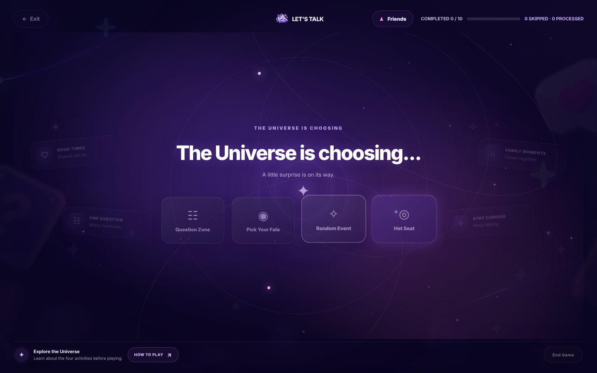
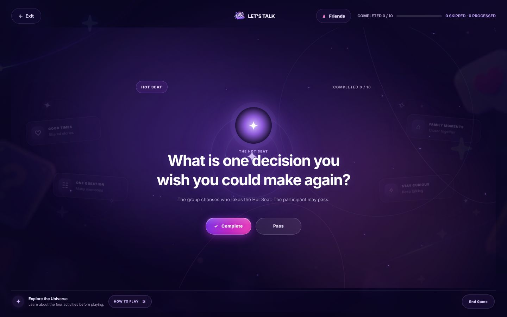
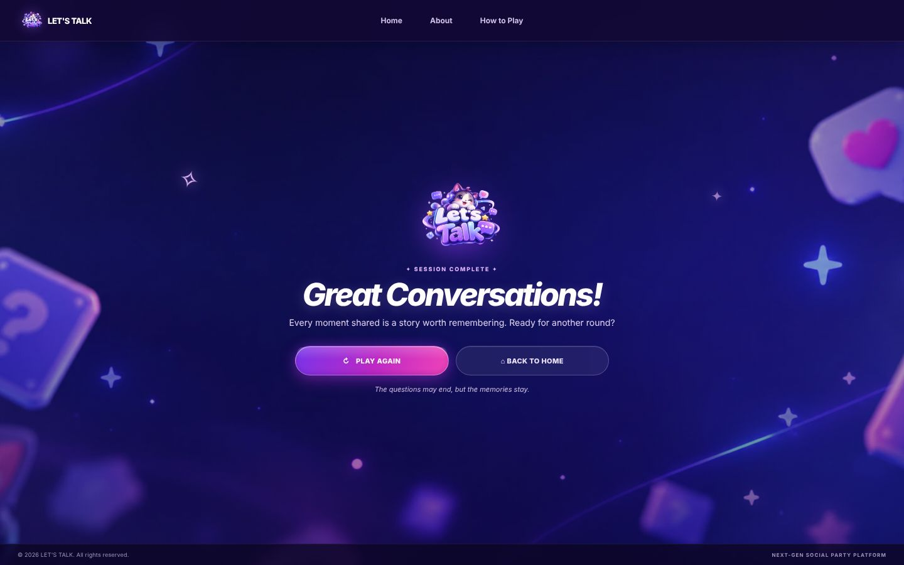
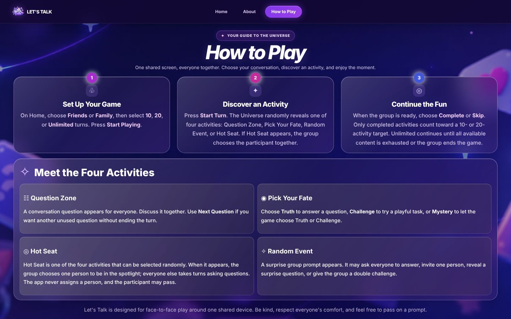
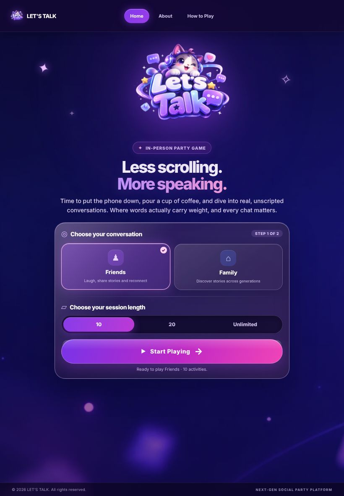
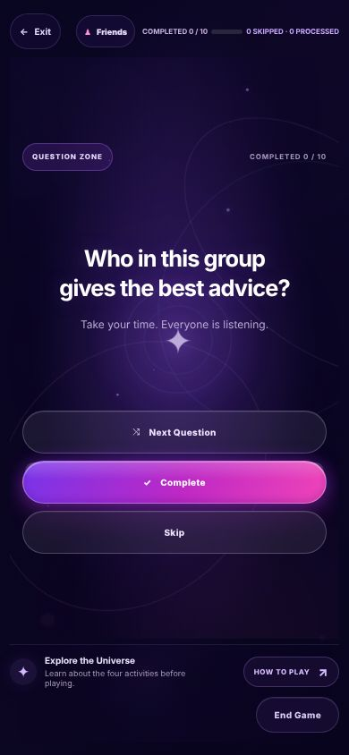
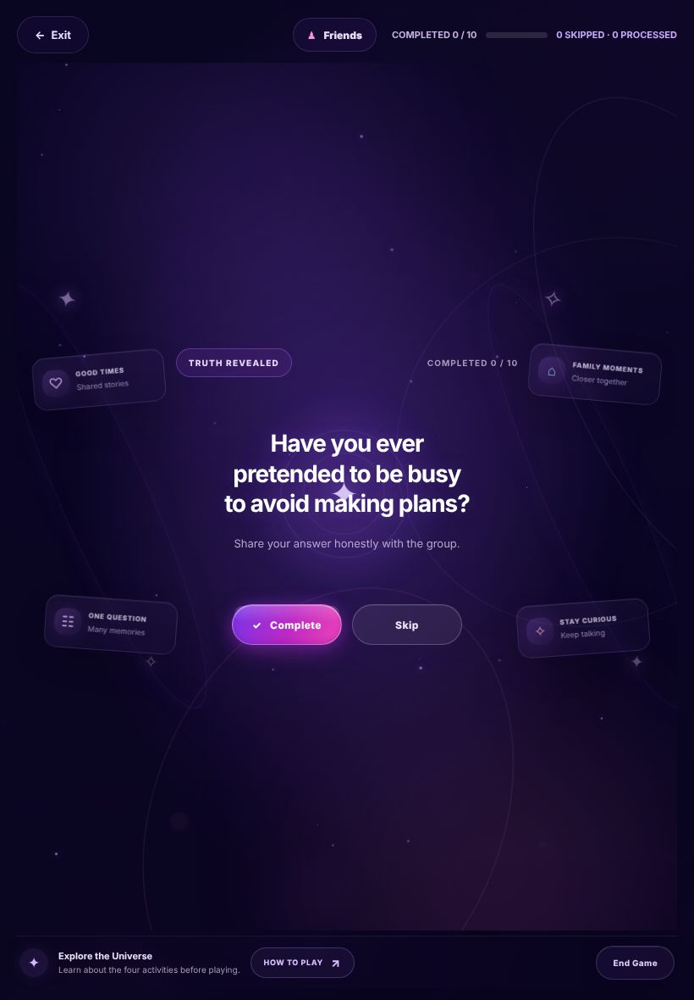
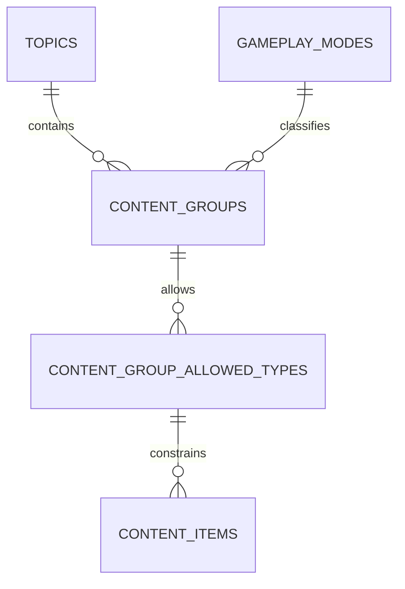

# LET'S TALK — Final Project Report

> Web Design and Development · Final Project. README này theo **Report Template** của môn học. Các ô `[...]` còn lại cần điền trước khi nộp. Tài liệu kỹ thuật chi tiết (kiến trúc, API, luật gameplay) nằm ở **Phụ lục A** cuối file và trong `docs/`.

## Thông Tin Nhóm

| Thông tin | Chi tiết |
|---|---|
| Tên nhóm | Nhóm 3 |
| Tên dự án | LET'S TALK — Less Scrolling. More Talking. |
| GitHub Repository | https://github.com/nguyenbaphat59-del/Let-s-Talk-project |
| Website (Frontend) | https://let-s-talk-project-frontend.vercel.app |
| Backend API | https://let-s-talk-backend-lk1u.onrender.com/api/v1/health |
| Video Demo | https://youtu.be/CBGHQs0oH-E |
| Ngày nộp | 29/11/2026 (theo biên bản kickoff 26/11/2026; chờ giảng viên xác nhận) |

### Thành viên nhóm

| Họ tên | GitHub | Vai trò |
|---|---|---|
| Nguyễn Thành Long | [`NguyenThanhLong-dev`] | M1 — Leader / Project Manager & Documentation |
| Võ Duy Anh | [`tuananhvo588-design`] | M2 — Frontend Developer (UI/UX) |
| Nguyễn Bá Phát | [`nguyenbaphat59-del`] | M3 — Backend & Database Developer |
| Trần Văn Huy | [VanHuyTran0oooo] | M4 — QA, Optimization & Monitoring |

Chi tiết trách nhiệm: [`docs/01_Team_Roles.md`](docs/01_Team_Roles.md).

---

## Tổng Quan Project và Công Nghệ Sử Dụng

### Mô tả ứng dụng

LET'S TALK là web app party game giúp bạn bè và gia đình bớt nhìn điện thoại và trò chuyện thật với nhau. Cả nhóm ngồi cùng nhau quanh **một thiết bị**, chọn chủ đề (Friends / Family) và độ dài phiên chơi (10, 20 hoặc Unlimited). Mỗi lượt, “Universe” chọn ngẫu nhiên một trong bốn hoạt động (Question Zone, Pick Your Fate, Random Event, Hot Seat) từ 880 câu hỏi và thử thách lưu trong PostgreSQL. Ứng dụng không cần tài khoản, không chấm điểm và không lặp nội dung trong cùng một phiên.

### Tech stack

| Layer | Công nghệ |
|---|---|
| Frontend |  HTML5, CSS3 (design system riêng: CSS custom properties, glassmorphism, keyframe animations), Tailwind CSS v4 (utility class, đang chuyển dần từng trang), Vanilla JavaScript
| Backend | Node.js 20+, Express 5, `helmet`, `express-rate-limit`, `cors`, `@supabase/supabase-js` |
| Database | PostgreSQL trên Supabase (5 bảng, Row Level Security, runtime read-only) |
| Deploy | Backend: Render · Frontend: Vercel |
| Monitoring | Google Analytics 4 (gtag.js), Sentry (Browser SDK tự host + `@sentry/node`), structured JSON logs |
| Testing | `node:test` (74 test tự động), validators trong `tools/`, Lighthouse 13 |

### Tính năng chính

- **Game Setup có kiểm tra dữ liệu:** chọn chủ đề và độ dài. Trang chủ gọi API kiểm tra kho nội dung của chủ đề trước khi cho bắt đầu.
- **Cinematic intro + roulette:** hiệu ứng mở đầu (có nút Skip) và vòng quay chọn hoạt động.
- **4 nhóm hoạt động ngẫu nhiên (25% mỗi nhóm khi cùng khả dụng):** Question Zone (có Next Question), Pick Your Fate (Truth / Challenge / Mystery 50-50), Random Event (Double Challenge, Pick a Player, …), Hot Seat (được Pass).
- **Tiến độ & điều khiển rõ ràng:** Complete / Skip / Pass cập nhật thanh tiến độ (Completed, Skipped, Processed). Các modal Exit, End Game và How to Play hỗ trợ phím Esc.
- **Không lặp nội dung, khôi phục phiên:** ID nội dung đã dùng được lưu trong Local Storage (schema v2) và được server kiểm tra lại. Tải lại trang thì vẫn ở đúng lượt chơi.
- **Responsive** cho mobile, tablet và desktop, có hỗ trợ `prefers-reduced-motion`.

| Home + Game Setup | Gameplay — roulette | Gameplay — hoạt động |
|---|---|---|
|  |  |  |
| **Pick Your Fate** | **How to Play modal** | **Game Complete** |
|  |  |  |

*Ảnh chụp từ bản chạy local (`npm run dev:frontend`). Nội dung câu hỏi lấy từ seed production `database/seeds/002_production_content.sql`.*

---
## Test nhanh

Dành cho người đánh giá muốn thử toàn bộ luồng chơi trong vài phút:

1. Mở https://let-s-talk-project-frontend.vercel.app. Backend chạy trên Render gói miễn phí nên lần đầu có thể mất 30–60 giây để thức dậy; nút **Start Playing** chỉ mở khi trang đã kiểm tra xong kết nối.
2. Chọn chủ đề (Friends hoặc Family) và độ dài phiên (10 / 20 / Unlimited), rồi bấm **Start Playing**.
3. Ở màn hình "Ready to Connect?", bấm **START TURN**. Hệ thống chọn ngẫu nhiên một trong bốn hoạt động (Question Zone, Pick Your Fate, Random Event, Hot Seat); làm theo hướng dẫn rồi bấm **Complete** hoặc **Pass**. Lặp lại vài lượt.
4. Bấm **End Game** để sang trang Game Complete, rồi thử **Play Again** hoặc **Back to Home**.
5. Thử trên điện thoại, hoặc Chrome DevTools ở chế độ thiết bị 390 px.

Lưu ý: Custom Deck (bộ câu hỏi tự tạo) chưa có trên bản live.

---

## Hướng Dẫn Cài Đặt và Chạy Ứng Dụng

### Yêu cầu hệ thống

| Công cụ | Phiên bản |
|---|---|
| Node.js | ≥ 20 |
| npm | ≥ 10 |
| Supabase project (PostgreSQL 15+) | Free tier là đủ |
| Trình duyệt | Chrome / Edge / Firefox / Safari bản mới |

### Các bước cài đặt

```bash
# 1. Clone repository
git clone https://github.com/nguyenbaphat59-del/Let-s-Talk-project.git
cd Let-s-Talk-project

# 2. Cài dependencies (npm workspaces: root + backend)
npm install

# 3. Cấu hình môi trường
cp .env.example .env
#    Điền SUPABASE_URL, SUPABASE_PUBLISHABLE_KEY (publishable/anon, KHÔNG dùng secret key)
#    ALLOWED_ORIGIN=http://localhost:5500,http://127.0.0.1:5500
#    SENTRY_DSN= (tuỳ chọn)

# 4. Khởi tạo database (Supabase → SQL Editor, chạy theo thứ tự)
#    database/schema.sql
#    database/seeds/001_reference_data.sql
#    database/seeds/002_production_content.sql
#    Kiểm tra: database/validation/validate_inventory.sql, security_check.sql
npm --workspace @lets-talk/backend run db:check   # xác nhận 880 nội dung, quyền read-only

# 5. Chạy ứng dụng (2 terminal)
npm run dev:backend    # http://localhost:1702/api/v1/health
npm run dev:frontend   # http://localhost:5500
```

**Ghi chú**

- Khi Frontend chạy ở cổng 5500, `frontend/js/api.js` tự gọi `http://localhost:1702/api/v1`. Bản production gọi Backend trên Render.
- Google Analytics và Sentry bật bằng cách điền ID vào `frontend/js/config.js` và `SENTRY_DSN` (xem [`docs/11_Monitoring_and_Analytics.md`](docs/11_Monitoring_and_Analytics.md)).
- Kiểm tra toàn bộ: `npm run check` (cú pháp, test, validators).

---

## Task 1: Project Planning & Teamwork

### (a) Phân công vai trò

Nhóm họp và thống nhất 4 vai trò, ma trận RACI và quyền sở hữu từng thư mục:

| Thành viên | Vai trò | Phụ trách chính |
|---|---|---|
| M1 Nguyễn Thành Long | Leader / PM & Docs | Đặc tả (PRD, kiến trúc), kế hoạch, GitHub workflow, README, điều phối peer review, video |
| M2 Võ Duy Anh | Frontend | Wireframe, 5 trang HTML/CSS, responsive, tương tác JS |
| M3 Nguyễn Bá Phát | Backend & Database | Schema/ERD, seed 880 nội dung, Express API, tích hợp, deploy Render |
| M4 Trần Văn Huy | QA, Optimization & Monitoring | Test, Lighthouse, GA4, Sentry, kiểm thử đa thiết bị |

Chi tiết: [`docs/01_Team_Roles.md`](docs/01_Team_Roles.md).

### (b) Wireframe

- **Công cụ:** Google Stitch (không dùng Figma) — dự án: https://stitch.google.com/projects/17284348942162000882
- **Các trang đã thiết kế** (desktop + mobile):
  - [x] Homepage + Game Setup
  - [x] About
  - [x] How to Play
  - [x] Gameplay (màn câu hỏi và màn idle; chưa có intro, roulette, các modal)
  - [x] Game Complete
- **Ảnh xuất:** `docs/wireframes/` — cách thực hiện, ngày tháng và giới hạn được ghi trung thực trong [`docs/wireframes/README.md`](docs/wireframes/README.md).

### (c) Project Plan

| Milestone | Thời gian thực tế | Trạng thái |
|---|---|---|
| Thiết kế Google Stitch + Prototype 1 → 2 (giảng viên duyệt) | Đầu 11/2026 → 20/11/2026 | Hoàn thành — Prototype 2 vào repo commit `738ed76` (20/11/2026) |
| Setup GitHub + database schema | 20/11/2026 – 21/11/2026 | Hoàn thành — `11469aa`, `1b904d8`, `database/schema.sql` |
| Giao diện cơ bản (5 trang, responsive) | 20/11/2026 | Hoàn thành — `738ed76` |
| Tích hợp database + API + trang động | 21/11/2026 | Hoàn thành — PR #3 (`a6bc8c3`), deploy Render (`a064c96`) |
| Tối ưu & monitoring | 21/11/2026 – 26/11/2026 | Hoàn thành — GA4 + Sentry Frontend (PR #28, #38), logo WebP (PR #44) |
| Peer review chéo (FocuSpace, Thai Tu Fashion) | 26/11/2026 – 28/11/2026 | Đang thực hiện — đã gửi FocuSpace#164 và thai_tu_fashion#51 ngày 26/11/2026; Thai Tu Fashion đã phản hồi ở issue #47 (xem Task 5(b)) |
| Đóng băng code | 28/11/2026, 20:00 | Chưa đến |
| Nộp bài | 29/11/2026 | Chưa nộp |

Scope, deliverables, phân công chi tiết theo issue và rủi ro: [`docs/02_Project_Plan.md`](docs/02_Project_Plan.md).

### (d) GitHub Repository

https://github.com/nguyenbaphat59-del/Let-s-Talk-project

### (e) GitHub Workflow

- **Luồng:** Issue → branch `<loại>/<issue>-<mô-tả>` (`feature/`, `fix/`, `perf/`, `docs/`, `test/`, `chore/`) → commit → Pull Request có ≥ 1 reviewer → merge vào `main`. Chi tiết trong [`CONTRIBUTING.md`](CONTRIBUTING.md), kèm PR/Issue templates trong `.github/`.
- **Commit message:** Conventional Commits `type(scope): mô tả (#issue)`. Ví dụ trong repo:

```text
feat(frontend): integrate frontend with backend API
fix(backend): allow configured CORS origins in production
perf(frontend): load fonts asynchronously and prioritise the LCP image
feat(backend): optional Sentry error monitoring and structured request logs
docs(optimization): record Lighthouse fixes and before/after re-run
```

- **Pull Request & issue:** PR tham chiếu issue bằng `Closes #n`. Các PR đã merge: #2 (`test-backend`), #3 (`integration/laptop-sync`). Backlog tuần 3 được tạo bằng `tools/github/create-issues.sh`.
- **Screenshot commit list / PR:** [chèn ảnh `docs/screenshots/github-commits.png`]

---

## Task 2: Implement User Interface

### (a) Các trang đã xây dựng

| Trang | URL/Route | Mô tả | Người thực hiện |
|---|---|---|---|
| Homepage + Game Setup | `/index.html` | Hero, chọn chủ đề và độ dài, kiểm tra kho nội dung qua API, bắt đầu game | M2 (UI), M3 (tích hợp API) |
| About | `/about.html` | Câu chuyện và sứ mệnh của dự án, CTA về Game Setup | M2 |
| How to Play | `/how-to-play.html` | 3 bước chơi, giải thích 4 hoạt động và các nút điều khiển | M2 |
| Gameplay | `/gameplay.html` | Intro, roulette, 4 hoạt động, tiến độ, modal Exit / End / Rules | M2 (UI), M3 (logic API/session) |
| Game Complete | `/game-complete.html` | Kết thúc phiên, Play Again / Back to Home | M2, M3 |

Điều hướng: header (Home · About · How to Play) trên các trang nội dung. Gameplay có Exit / End Game kèm modal xác nhận. Từ trang Complete có thể chơi lại hoặc về Home.

| Home | About | How to Play |
|---|---|---|
|  |  |  |

#### Đối chiếu wireframe và giao diện thật

Wireframe thiết kế bằng Google Stitch (ảnh trong `docs/wireframes/`), giao diện thật là bản live hiện tại (ảnh trong `docs/screenshots/`). Biên bản duyệt thiết kế lập bổ sung: [`docs/meetings/2026-11-06-design-review.md`](docs/meetings/2026-11-06-design-review.md).

| Trang | Ảnh | Giữ đúng như thiết kế | Điểm lệch | Lý do |
|---|---|---|---|---|
| Home + Game Setup | Wireframe: `01-home-desktop.png`<br>Thật: `index-desktop.jpg` | Bố cục 2 cột: tiêu đề và khung Setup bên trái, mascot bên phải. Header có logo và 3 link Home, About, How to Play. Nút chọn 10/20/Unlimited, nút Start Playing, nhãn "Step 1 of 2". Footer "NEXT-GEN SOCIAL PARTY PLATFORM". | Thiết kế có 3 chủ đề (Friends, Love, Family), bản thật chỉ có Friends và Family. Nhãn "OFFLINE PARTY GAME" → "IN-PERSON PARTY GAME". "Less Scrolling. More Talking." → "Less scrolling. More speaking.". Đoạn mô tả được viết lại. "1. Choose a Topic" → "Choose your conversation". "2. Number of Questions" kèm nhãn "10 Prompts" → "Choose your session length", bỏ nhãn. Mô tả chủ đề: Friends "Get closer with your friends" → "Laugh, share stories and reconnect"; Family "Meaningful talks with family" → "Discover stories across generations". Dòng dưới nút "Ready for immediate offline pass-and-play." → "Ready to play Friends · 10 activities." | Bỏ "Love" theo quyết định DEC-01 (chỉ Friends/Family). Đổi "questions" thành "activities" vì game có 4 loại hoạt động. Dòng dưới nút cho biết chủ đề và số lượt đã chọn. Vì mục đích để tinh giảm quy mô của cơ sở dữ liệu và cảm thấy chủ đề này không cần thiết. |
| About | Wireframe: `02-about-desktop.png`<br>Thật: `about-desktop.jpg` | Tiêu đề "Why Let's Talk?" và dòng phụ "Bringing real-world warmth back to our gatherings.". Ảnh minh hoạ nhóm bạn cùng mascot làm nền toàn trang. 3 đoạn nội dung The Disconnect, The Solution, Mission. Nút "GO TO GAME SETUP" ở góc dưới trái. Header 3 link, mục About được tô sáng. | Thiết kế có nhãn "OUR STORY & VISION" và khung kính bao 3 đoạn; bản thật bỏ nhãn và bỏ khung, chữ đặt trực tiếp lên ảnh nền, cỡ chữ lớn hơn. Nội dung viết lại: đoạn 1 "In a world filled with endless feeds..." → "In an era dominated by infinite feeds and endless notification pings..."; đoạn 2 "Let's Talk was created as a simple face-to-face conversation companion..." → "Let's Talk was built to bridge that gap...". Đoạn 3 "The Mascot & Mission" → "MISSION", bỏ câu về mascot và bỏ chữ "couples" ("friends, couples, and families" → "friends and families"). Logo trong wireframe bị lỗi (hiện tên tệp), bản thật hiển thị đúng. Footer "© 2025" → "© 2026". | Bỏ "couples" vì không còn chủ đề Love. Lý do bỏ khung kính và nhãn "OUR STORY & VISION", tăng cỡ chữ nhằm dễ đọc và cảm thấy phù hợp với mục tiêu của dự án. |
| How to Play | Wireframe: `03-how-to-play-desktop.png`<br>Thật: `how-to-play-desktop.jpg` | Tiêu đề "How to Play". Hàng trên có 3 thẻ đánh số 1, 2, 3 kèm biểu tượng, bên dưới là một khối lớn. Header 3 link, mục How to Play được tô sáng. Nền tím cùng phong cách. | Nhãn "SUPER SIMPLE RULES" → "YOUR GUIDE TO THE UNIVERSE". Mô tả "Three easy steps..." → "One shared screen, everyone together...". 3 bước "Choose Your Topic / Pick Your Length / Start Talking" → "Set Up Your Game / Discover an Activity / Continue the Fun". Bước chọn chủ đề không còn Love, bước chọn độ dài gộp vào bước 1. Khối "Game Controls" (Shuffle, Next Question, Exit Game, Finish Session) → "Meet the Four Activities" (Question Zone, Pick Your Fate, Hot Seat, Random Event). Nút "GO TO GAME SETUP" không thấy trong ảnh bản thật, thay bằng dòng lưu ý chơi trực tiếp quanh một thiết bị. | Gameplay đổi sau góp ý Prototype 1 của giảng viên ("quá đơn giản") thành 4 hoạt động ngẫu nhiên (PRD v1.4), nên không còn nút Shuffle. |
| Gameplay (màn chơi chính) | Wireframe: `04-gameplay-desktop.png`<br>Thật: `gameplay-activity-desktop.jpg` | Nền tím, nội dung ở giữa màn hình. Chip chủ đề "Friends". Nút Exit ở góc trên trái, End Game ở phía dưới. Có chỉ báo tiến độ. Câu hỏi chữ lớn kèm dòng gợi ý nhỏ bên dưới. Nút hành động chính màu gradient. | Thiết kế có header menu site (Home, About, How to Play), bản thật bỏ menu và dùng thanh trên gồm Exit, logo, chủ đề, tiến độ. Chip "10 Questions" → "COMPLETED 0 / 10" kèm thanh tiến độ và "0 SKIPPED · 0 PROCESSED". Nhãn "QUESTION 1/10" → nhãn loại hoạt động (ví dụ "HOT SEAT"). Thẻ câu hỏi dạng khung → câu hỏi chữ lớn giữa màn hình. Nút "Shuffle / Next Question" → "Complete / Pass". "Exit Game" → "Exit". Bản thật thêm thanh dưới "Explore the Universe" với nút "HOW TO PLAY". | Cùng lý do 4 hoạt động. Tiến độ tính theo Complete/Skip. Lý do bỏ menu site nhằm giúp người chơi tập trung vào được câu hỏi hơn. |
| Gameplay (màn chỉ có ở bản thật) | Wireframe: không có<br>Thật: `gameplay-intro-desktop.jpg`, `gameplay-idle-desktop.jpg`, `gameplay-roulette-desktop.jpg`, `gameplay-fate-desktop.jpg`, `gameplay-end-modal-desktop.jpg` | Không áp dụng, wireframe không có các màn này. | Bản thật thêm: màn intro "DROP YOUR PHONE. LET'S PLAY." có nút "Skip intro"; màn chờ "Ready to Connect?" với nút "START TURN"; màn quay chọn "The Universe is choosing..." giữa 4 hoạt động; màn Pick Your Fate với Truth, Challenge, Mystery và nút "Skip activity"; hộp thoại "End this game?" (Keep Playing, End Game) cho biết chỉ hoạt động đã hoàn thành được tính. Chế độ Unlimited hiện "8 COMPLETED · 0 SKIPPED" và "UNLIMITED". | Làm gameplay đa dạng hơn sau góp ý Prototype 1 của giảng viên (4 hoạt động ngẫu nhiên). Lý do thêm intro và hộp thoại xác nhận kết thúc nhằm tạo cảm giác cho người chơi phải chú ý và tập trung vào mục đích trò chơi. |
| Game Complete | Wireframe: `05-complete-desktop.png`<br>Thật: `game-complete-desktop.jpg` | Logo mascot ở giữa, tiêu đề "Great Conversations!", 2 nút "PLAY AGAIN" và "BACK TO HOME". Nền tím với các biểu tượng trang trí bay. Header 3 link, footer cùng nội dung. | Thiết kế có 2 thẻ tổng kết (Questions 10, Topic Friends) và dòng "You've sparked 10 meaningful conversations with your Friends."; bản thật bỏ 2 thẻ, thay dòng mô tả bằng "Every moment shared is a story worth remembering. Ready for another round?". Bản thật thêm nhãn "SESSION COMPLETE" phía trên tiêu đề và dòng nghiêng "The questions may end, but the memories stay." dưới hai nút. Chữ rác "ORKLES" trong wireframe không còn. | Lý do bỏ 2 thẻ tổng kết do chế độ Unlimited không có số lượt cố định và chỉ tính hoạt động đã hoàn thành. |

Điểm lệch chung:

- Logo trong wireframe bị lỗi ở About, How to Play và Gameplay (hiện tên tệp thay vì hình). Bản thật hiển thị logo bình thường.
- Wireframe Gameplay và Game Complete có chữ rác "ORKLES" do Stitch sinh ra. Bản thật không có.
- Footer wireframe ghi "© 2025", bản thật ghi "© 2026".

### (b) Sử dụng Tailwind CSS

**Có sử dụng Tailwind CSS v4, đang chuyển dần từng trang.** Tailwind được cài bằng gói npm (`tailwindcss`, `@tailwindcss/cli`, devDependency), **không dùng CDN**. File nguồn [`frontend/css/tailwind.css`](frontend/css/tailwind.css) khai báo token màu, font, bán kính và breakpoint lấy từ [`docs/DESIGN-SYSTEM.md`](docs/DESIGN-SYSTEM.md) và `site.css`. Lệnh `npm run build:css` build ra [`frontend/css/app.css`](frontend/css/app.css) (đã minify). `app.css` được commit sẵn nên Vercel không cần bước build; mỗi khi thêm hoặc đổi class trong HTML/JS phải chạy lại lệnh build và commit `app.css`. Nhóm không nạp preflight (CSS reset) của Tailwind vì `site.css` đã có reset riêng; như vậy các trang chưa chuyển không bị đổi giao diện. Ở phần đã chuyển, rule CSS viết tay tương ứng trong `site.css` được xoá và thay bằng utility class.

| Trang | Phần đã dùng utility class | Theo dõi |
| --- | --- | --- |
| Game Complete | Khối nút hành động và dòng chú thích: grid, gap, margin, độ rộng, responsive (`max-sm:`, `short-desktop:`) | [#41](https://github.com/nguyenbaphat59-del/Let-s-Talk-project/issues/41) |
| Home, Gameplay | Chưa chuyển (kế hoạch) | — |
| About, How to Play | Chưa chuyển (kế hoạch) | — |

Glassmorphism, keyframe animation và component dùng chung (`.btn`, `.glass-panel`, …) vẫn viết bằng CSS trong `site.css` và `gameplay.css`.

### (c) Các tính năng tương tác

| Tính năng | Mô tả | File/Component | Người thực hiện |
|---|---|---|---|
| Chọn chủ đề / độ dài | Toggle có `aria-pressed`, ghi nhớ lựa chọn, phản hồi trạng thái qua `aria-live` | `homepage.js` | M2 |
| Kiểm tra trước khi bắt đầu | Gọi catalog API, khoá nút khi đang tải, báo lỗi nếu chủ đề hết nội dung hoặc mất mạng | `homepage.js`, `api.js` | M3 |
| Cinematic intro | Hiệu ứng mở đầu nhiều lớp, có nút Skip | `gameplay.html`, `gameplay.js` | M2 |
| Roulette chọn hoạt động | Hiệu ứng quay dừng ở hoạt động do server chọn | `gameplay.js` | M2 |
| Pick Your Fate | 3 cổng Truth / Challenge / Mystery, tự vô hiệu hoá cổng hết nội dung | `gameplay.js` | M2, M3 |
| Next Question | Đổi câu hỏi (animation shuffle), không tăng tiến độ | `gameplay.js` | M2 |
| Complete / Skip / Pass + progress | Cập nhật thanh tiến độ và bộ đếm; kết thúc khi đạt 10/20 | `gameplay.js`, `session.js` | M2, M3 |
| Modal Exit / End Game / How to Play | Hộp thoại xác nhận (`role="dialog"`), đóng bằng Esc hoặc click nền | `gameplay.html`, `gameplay.js` | M2 |
| Khôi phục phiên | Tải lại trang vẫn giữ nguyên lượt hiện tại (Local Storage v2, có kiểm tra dữ liệu bị sửa) | `session.js`, `storage.js` | M3 |
| Thông báo lỗi | Lỗi mạng, hết nội dung và phiên hỏng đều có thông báo dễ hiểu | `gameplay.js`, `homepage.js` | M2, M3 |

**Kiểm thử:** `frontend/test/session.test.js` và `api.test.js` (session, chống lặp, khôi phục, xử lý lỗi), cùng kiểm thử thủ công trên 3 kích thước màn hình. Chưa có bộ kiểm thử tự động đầu-cuối (end-to-end); luồng setup → intro → 4 loại hoạt động → End Game → Complete được kiểm thử thủ công, kết quả do M4 tổng hợp (đang hoàn thiện).

| Intro | Rules modal | End Game modal |
|---|---|---|
|  |  |  |

### (d) Giao diện trên nhiều thiết bị

- [x] Mobile (< 768px) — kiểm tra ở 320, 375, 390, 414 px
- [x] Tablet (768px – 1024px) — 768, 820, 1023 px
- [x] Desktop (> 1024px) — 1024, 1280, 1440, 1920 px (kể cả màn hình thấp và landscape)

| Mobile (390px) | Tablet (820px) | Desktop (1440px) |
|---|---|---|
|  |  |  |
|  |  |  |

---

## Task 3: Database Integration & Dynamic Content

### (a) Thiết kế cơ sở dữ liệu

- **Hệ quản trị:** PostgreSQL (Supabase)
- **Số bảng:** 5 · **Dữ liệu:** 2 topics, 4 gameplay modes, 16 content groups, 18 allowed-type mappings, 880 content items

| Bảng | Mô tả | Các cột chính |
|---|---|---|
| `topics` | Chủ đề chơi (Friends, Family) | `id` PK, `code` UNIQUE, `name`, `is_active` |
| `gameplay_modes` | 4 nhóm hoạt động | `id` PK, `code` UNIQUE, `name`, `display_order` |
| `content_groups` | Kho nội dung theo chủ đề × hoạt động (vd. `truth`, `double_challenge`) | `id` PK, `topic_id` FK, `gameplay_mode_id` FK, `code`, `is_active` |
| `content_group_allowed_types` | Loại nội dung hợp lệ của từng kho (`question` / `challenge`) | (`content_group_id` FK, `content_type`) PK |
| `content_items` | 880 câu hỏi / thử thách | `id` PK (UUID), (`content_group_id`, `content_type`) FK, `content_text`, `is_active` |



ERD đầy đủ (kèm kiểu dữ liệu, ràng buộc, RLS): [`docs/03_Database_Schema.md`](docs/03_Database_Schema.md) · SQL: [`database/schema.sql`](database/schema.sql).

### (b) Kết nối cơ sở dữ liệu

- **Server-side:** Node.js 20 + Express 5
- **Phương thức:** RESTful API `/api/v1` (OpenAPI 3.1: [`docs/openapi.yaml`](docs/openapi.yaml)). Backend dùng `@supabase/supabase-js` với publishable key.
- **CRUD:**
  - [ ] Create
  - [x] Read
  - [ ] Update
  - [ ] Delete

  Đây là quyết định thiết kế có chủ đích (PRD, Solution Architecture). Ứng dụng không có tài khoản người dùng, và phiên chơi được lưu ở Local Storage của trình duyệt. Vì vậy runtime chỉ cần **đọc** nội dung. Supabase RLS chỉ cấp quyền SELECT cho role `anon`, còn INSERT/UPDATE/DELETE bị chặn trên cả 5 bảng (`database/validation/security_check.sql`). Nhờ đó khoá dùng ở server không thể sửa nội dung. Việc tạo/sửa/xoá nội dung do nhóm thực hiện qua SQL seed/migration có kiểm soát phiên bản (`database/seeds/`).
- **Kiến trúc:**

```text
Browser (HTML/CSS/JS, Local Storage session)
   │  fetch JSON  (CORS allowlist, rate limit 60 req/phút cho gameplay)
   ▼
Express API (Render)  — validate input → GameplayService (chọn ngẫu nhiên an toàn, chống lặp)
   │  @supabase/supabase-js (publishable key, SELECT only)
   ▼
Supabase PostgreSQL (5 bảng, RLS)
```

### (c) Các trang hiển thị dữ liệu động

| Trang | Dữ liệu hiển thị | Query/Endpoint | Người thực hiện |
|---|---|---|---|
| Home (Game Setup) | Tên chủ đề và số nội dung còn khả dụng của 9 kho. Chặn bắt đầu nếu kho rỗng. | `GET /api/v1/topics/:topicCode/catalog` | M3 |
| Gameplay | Hoạt động do server chọn và câu hỏi/thử thách tương ứng, lọc theo chủ đề và các ID đã dùng | `POST /api/v1/gameplay/next-activity`, `/resolve-fate`, `/question-zone/next` | M3 |
| Game Complete | Play Again tải lại catalog của chủ đề vừa chơi để tạo phiên mới | `GET /api/v1/topics/:topicCode/catalog` | M3 |

Dữ liệu thay đổi theo lựa chọn của người dùng (chủ đề, Truth/Challenge/Mystery) và theo các ID đã dùng trong phiên. Phần kiểm thử gồm 41 test Backend (service, repository, HTTP integration) và `npm run db:check` (đối chiếu đúng 880 nội dung trên Supabase thật).

| Gameplay — Question Zone (mobile) | Gameplay — Hot Seat (desktop) |
|---|---|
|  |  |

---

## Task 4: Optimization

### (a) Lighthouse performance check

**Trước khi tối ưu** (Chrome DevTools, 21/11/2026, `localhost:5500`, trang Home):

| Chỉ số | Desktop | Mobile |
|---|---|---|
| Performance | 94 | 71 |
| Accessibility | 100 | 100 |
| Best Practices | 100 | 100 |
| SEO | 100 | 100 |


**Các vấn đề và cách khắc phục:**

| Vấn đề | Hành động khắc phục |
|---|---|
| Render-blocking: stylesheet Google Fonts chặn lần vẽ đầu | Preload + áp dụng bất đồng bộ (`media="print" onload`), có `<noscript>` fallback |
| Ảnh không khai báo `width`/`height` | Thêm kích thước gốc `1200×957` cho logo; CSS vẫn quyết định kích thước hiển thị nên layout không đổi |
| LCP request discovery (thiếu `fetchpriority=high`) | `<link rel="preload" as="image" fetchpriority="high">` cho ảnh LCP |
| Script analytics/monitoring có thể làm chậm tải | `gtag.js` chỉ tải sau sự kiện `load`; Sentry SDK tự host tải `async`, không chặn hiển thị; mọi script dùng `defer` |
| Improve image delivery (~1 MB logo PNG) | Logo chuyển WebP (123 KB cho bản 800 px, PNG giữ làm fallback trong `<picture>`) — [PR #44](https://github.com/nguyenbaphat59-del/Let-s-Talk-project/pull/44) |

**Sau khi tối ưu** (đo lại cùng phương pháp, Lighthouse 13 headless, `bash tools/lighthouse-audit.sh`):

| Trang / thiết bị | Performance trước → sau | FCP trước → sau | Accessibility | Best Practices | SEO |
|---|---|---|---|---|---|
| Home — Mobile | 75 → 76 | 1.5 s → 1.3 s | 100 | 100 | 100 |
| Home — Desktop | 96 → 96 | 0.4 s → 0.3 s | 100 | 100 | 100 |
| About — Mobile | 100 → 100 | 1.5 s → 1.3 s | 100 | 100 | 100 |
| How to Play — Mobile | 99 → 100 | 1.6 s → 1.3 s | 100 | 100 | 100 |

Ba audit (unsized images, LCP discovery, render-blocking fonts) chuyển từ *failed* sang *passed*. FCP giảm khoảng 0.2–0.3 s trên mọi trang. LCP mobile của trang Home khoảng 7.9 s là số đo **trước** khi nén logo (phần tử LCP khi đó là `lets-talk-logo.png` dung lượng 1 MB). Logo đã chuyển sang WebP 800 px (123 KB) ở [PR #44](https://github.com/nguyenbaphat59-del/Let-s-Talk-project/pull/44); số đo Lighthouse sau thay đổi này sẽ được cập nhật ở M4-3 (#64). Báo cáo HTML đầy đủ ở [`docs/optimization/lighthouse/reports/`](docs/optimization/lighthouse/reports/), phân tích ở [`docs/optimization/lighthouse/README.md`](docs/optimization/lighthouse/README.md) §10. Bằng chứng sau tối ưu là các báo cáo Lighthouse HTML đầy đủ (mở được bằng trình duyệt) trong thư mục trên.

### (b) Error and user-behavior monitoring

**Google Analytics**

- [x] Đã tích hợp GA4 (`frontend/js/analytics.js`, tải sau `load`, tắt trên localhost)
- **Measurement ID:** `G-187Q24EEMY` (khai báo trong `frontend/js/config.js`) · Web data stream ID: `1638866491`
- **Tích hợp:** `page_view` tự động, cộng với 17 sự kiện gameplay (`game_start`, `activity_drawn` theo `activity_family`, `fate_choice`, `activity_complete`/`activity_skip`, `game_complete`, `api_error`, …) lấy từ ID nút và kết quả API, không sửa logic game và không gửi dữ liệu cá nhân.
- **Screenshot dashboard:** GA4 → Báo cáo → Thời gian thực, thẻ "Số lượng sự kiện theo Tên sự kiện" (26/11/2026, sau một lượt chơi thử): [`ga-realtime-events.png`](docs/optimization/monitoring/ga-realtime-events.png) với `activity_drawn` (22), `turn_start` (22), `activity_complete` (20), `select_topic` (7), `fate_choice` (6) và `page_view` (8).

**Sentry**

- [x] Đã tích hợp Sentry — Frontend (Browser SDK tự host, `frontend/js/vendor/sentry.min.js`) và Backend (`@sentry/node`)
- **DSN / cấu hình:** Frontend `LT_CONFIG.sentryDsn` · Backend biến môi trường `SENTRY_DSN` (tuỳ chọn, được kiểm tra khi khởi động)
- **Loại lỗi được theo dõi:**
  - Frontend: uncaught exception, unhandled promise rejection (kể cả lỗi xảy ra trước khi SDK tải xong), lỗi API (mất mạng, 5xx, response không đọc được, mã 4xx bất thường) kèm `endpoint`, `status`, `code` và `requestId`
  - Backend: mọi lỗi 500 và `ApiError` ≥ 500 (ví dụ Supabase không truy cập được), gắn tag `request_id`, `http.method`, `http.path`
  - Log: mỗi request ghi một dòng JSON (`time, level, requestId, method, path, status, durationMs`). Cùng một `requestId` xuất hiện ở response, Sentry và Render logs nên có thể truy vết một lỗi từ đầu đến cuối.
- **Screenshot dashboard / error log:**
  - Frontend: lỗi thử bắn trên bản Vercel (cửa sổ ẩn danh, 26/11/2026) từ Chrome DevTools ở chế độ giả lập thiết bị nên Sentry ghi nhận trình duyệt "Mobile Safari/iOS". [Danh sách Issues](docs/optimization/monitoring/sentry-frontend-issue-list.png) · [Chi tiết issue `LETSTALKFRONTEND-1` (`environment: production`, đã che địa chỉ IP)](docs/optimization/monitoring/sentry-frontend-issue-detail.png)
  - Backend: log Render xác nhận giám sát Sentry đã bật (chụp lại ngày 27/11/2026: dòng `[MONITORING] Sentry error monitoring enabled.` lúc khoảng 17:37 giờ Việt Nam, khi backend khởi động lại; ảnh cũ không đọc được ngày nên đã thay): [`render-sentry-enabled.png`](docs/optimization/monitoring/render-sentry-enabled.png). Chưa có ảnh một lỗi 5xx backend đã hiện trong Sentry.
  - Hạn chế: tiện ích chặn quảng cáo của trình duyệt chặn yêu cầu gửi lỗi tới Sentry (và GA) với `ERR_BLOCKED_BY_CLIENT`, nên người dùng có tiện ích này không gửi được lỗi. Chưa cấu hình `tunnel` của Sentry.

Chi tiết và cách kiểm chứng: [`docs/11_Monitoring_and_Analytics.md`](docs/11_Monitoring_and_Analytics.md).

---

## Task 5: UI/UX Peer Review & Evaluation

### (a) Feedback cho nhóm khác

Nhóm review 2 nhóm theo 3 tiêu chí (Usability, Aesthetics, User-Friendliness); bài review đăng thành issue trên repo của nhóm đó và được lưu lại trong [`docs/peer-review/reviews-given/`](docs/peer-review/reviews-given/):

| Nhóm được review | Issue đã đăng | Người review | File trong repo | Phản hồi |
|---|---|---|---|---|
| FocuSpace (Nhóm 2) | [FocuSpace#164](https://github.com/CaoLePhucThinh2203/FocuSpace/issues/164) — 26/11/2026 | M1 Nguyễn Thành Long | [`focuspace.md`](docs/peer-review/reviews-given/focuspace.md) | Chưa có |
| Thai Tu Fashion (Nhóm 5) | [thai_tu_fashion#51](https://github.com/huynhsy986-droid/thai_tu_fashion/issues/51) — 26/11/2026 | M4 Trần Văn Huy | [`thai-tu-fashion.md`](docs/peer-review/reviews-given/thai-tu-fashion.md) | Chưa có |

### (b) Xử lý feedback nhận được

| Feedback | Nguồn | Quyết định | Lý do/Commit |
|---|---|---|---|
| Giao diện Prototype 1 quá đơn giản, chưa hấp dẫn | Giảng viên | ✅ Đã thực hiện | Prototype 2 làm lại toàn bộ lớp hình ảnh (glass panel, gradient, mascot, animation) — `738ed76` |
| Gameplay đơn điệu, chưa đủ hứng thú | Giảng viên | ✅ Đã thực hiện | 4 nhóm hoạt động ngẫu nhiên, intro, roulette (PRD v1.4) — `738ed76`, `a6bc8c3` |
| "Chuyển trạng thái giữa các lượt chơi chưa có phản hồi tải trang rõ ràng" | Thai Tu Fashion (#47) | ✅ Đã thực hiện | Gameplay hiện thông báo đang tải và giải thích khi máy chủ phản hồi chậm — PR #69 (`2c25d61`), M3 đã kiểm tra với độ trễ 8000 ms |
| "Một số khu vực trên màn hình nhỏ còn hơi chật"; ưu tiên 1: bố cục trên di động | Thai Tu Fashion (#47) | ⏸ Hoãn | Chưa kịp trước hạn nộp 29/11/2026; việc còn lại (vùng bấm ~44 px, cỡ chữ tối thiểu ≤599 px, kiểm tra 360/390 px) ghi trong `docs/peer-review/received-feedback.md`; #47 giữ mở |
| "Đối chiếu thêm giữa repo và bản chạy live" | Thai Tu Fashion (#47) | ✅ Đã thực hiện | README ghi rõ Custom Deck chưa có trên bản live (PR #70); bảng đối chiếu wireframe ↔ giao diện thật ở README 2(a), biên bản `docs/meetings/2026-11-06-design-review.md` (PR #72) |
| Ưu tiên 2: README hướng dẫn test nhanh | Thai Tu Fashion (#47) | ✅ Đã thực hiện | Thêm mục "Test nhanh" ở đầu README |

Góp ý từ nhóm khác: ngày 26/11/2026 nhóm đã nhờ FocuSpace (trong #164) và Thai Tu Fashion (trong #51) review lại Let's Talk. Nhóm Thai Tu Fashion đã gửi góp ý trong issue [#47](https://github.com/nguyenbaphat59-del/Let-s-Talk-project/issues/47) (khoảng 21:30 ngày 26/11/2026); nội dung nguyên văn, quyết định và PR tương ứng nằm trong nhật ký bên dưới. 

Nhật ký đầy đủ và nguyên tắc ra quyết định: [`docs/peer-review/received-feedback.md`](docs/peer-review/received-feedback.md).

---

## Deliverables Checklist

- [ ] Source code trên GitHub (public hoặc đã share cho giảng viên), mọi branch đã merge qua PR
- [x] README.md có hướng dẫn cài đặt, tổng quan, danh sách tính năng kèm screenshot và ERD
- [ ] Video demo YouTube (≤ 10 phút, ≥ 720p, không để private)
- [ ] Self-report của từng thành viên đã commit vào `docs/self-reports/`

## Self-Reports

| Họ tên | Link Self-Report |
|---|---|
| Nguyễn Thành Long | [self-report-nguyen-thanh-long.md](docs/self-reports/self-report-nguyen-thanh-long.md) |
| Võ Duy Anh | [self-report-vo-duy-anh.md](docs/self-reports/self-report-vo-duy-anh.md) |
| Nguyễn Bá Phát | [self-report-nguyen-ba-phat.md](docs/self-reports/self-report-nguyen-ba-phat.md) |
| Trần Văn Huy | [self-report-tran-van-huy.md](docs/self-reports/self-report-tran-van-huy.md) |

---

## Phụ lục A — Tài liệu kỹ thuật

> Nội dung README kỹ thuật trước đây, giữ nguyên văn (chỉ hạ một cấp tiêu đề).

## LET'S TALK

LET'S TALK is an online party-game web application designed for friends and family physically together around one shared browser/device. “Face-to-face” describes the play context; the website itself is online-only.

### Current architecture

- **Frontend:** HTML, CSS, Vanilla JavaScript in `frontend/`.
- **Backend:** Node.js 20+ and Express 5 in `backend/`.
- **Database:** Supabase PostgreSQL, accessed read-only by the Backend through `@supabase/supabase-js`.
- **Session ownership:** Browser Local Storage schema v2. The Backend does not persist sessions, players, turn counts, or usage history.
- **API:** Stateless REST endpoints under `/api/v1`.
- **Content:** 880 production prompts across Friends and Family (640 questions + 240 challenges) stored in Supabase.
- **Prototype JSON:** `frontend/data/` is retained as reference/legacy sample data; production gameplay JavaScript no longer loads those JSON files.

### Project structure

```text
lets-talk/
├── frontend/
│   ├── index.html
│   ├── about.html
│   ├── how-to-play.html
│   ├── gameplay.html
│   ├── game-complete.html
│   ├── css/
│   ├── js/
│   │   ├── api.js
│   │   ├── storage.js
│   │   ├── session.js
│   │   ├── homepage.js
│   │   ├── gameplay.js
│   │   └── game-complete.js
│   ├── data/                 # prototype/reference only
│   ├── assets/images/
│   └── server.mjs            # local static preview only
├── backend/
│   ├── server.js             # Express entrypoint; default export for Vercel
│   ├── package.json
│   ├── README.md
│   ├── src/
│   │   ├── app.js
│   │   ├── config/
│   │   ├── errors/
│   │   ├── middlewares/
│   │   ├── repositories/
│   │   ├── routes/
│   │   ├── services/
│   │   └── utils/
│   └── test/
├── database/
├── docs/
├── tools/
├── .env.example
├── .gitignore
├── package.json
└── README.md
```

### Gameplay rules implemented by the API

- Automatic main families are Question Zone, Pick Your Fate, Random Event, and Hot Seat, selected uniformly among currently eligible families. When all four are eligible, each has a 25% probability.
- Hot Seat is part of the automatic roulette; the group verbally chooses the participant and the participant may pass.
- Truth and Challenge use independent pools. Mystery is a secure 50/50 choice only when both pools have remaining content.
- Random Event selects uniformly among eligible subtypes. Double Challenge requires two distinct unused prompts. Pick a Player is available only when both its Question and Challenge pools remain, and its type is selected 50/50; the group chooses the participant verbally.
- Used IDs are validated against the selected topic, group, and content type. No silent pool substitution or reuse is allowed.
- Complete increments Completed and Processed. Skip and Hot Seat Pass increment Skipped and Processed. Next Question consumes another Question Zone item but does not advance progression.
- Finite sessions end only when 10 or 20 activities have been completed. Unlimited ends on full content exhaustion or End Game.

### Local setup

Requirements: Node.js 20+ and npm.

1. Copy `.env.example` to `.env` at the repository root.
2. Set your Supabase project URL and **publishable** key:
   - `SUPABASE_URL`
   - `SUPABASE_PUBLISHABLE_KEY`
3. For local development, keep `ALLOWED_ORIGIN` set to the exact Frontend origin(s), such as `http://localhost:5500,http://127.0.0.1:5500`.
4. Install workspace dependencies:

   ```bash
   npm install
   ```

5. Start the Backend in Terminal 1:

   ```bash
   npm run dev:backend
   ```

6. Start the Frontend in Terminal 2:

   ```bash
   npm run dev:frontend
   ```

7. Open `http://localhost:5500`.

The Frontend development API client routes requests to `http://localhost:1702/api/v1` when the site is served on port 5500. For another development port or API host, set `window.LT_API_BASE_URL` before the application scripts load.

### API endpoints

- `GET /api/v1/health`
- `GET /api/v1/topics`
- `GET /api/v1/topics/:topicCode/catalog`
- `POST /api/v1/gameplay/next-activity`
- `POST /api/v1/gameplay/resolve-fate`
- `POST /api/v1/gameplay/question-zone/next`

See `docs/04_API_Documentation.md` and `docs/openapi.yaml` for the full contract.

The Member 3 implementation and verification summary is in `docs/09_STEP3_BACKEND_COMPLETION_REPORT.md`; the file-by-file change inventory is in `docs/10_STEP3_CHANGED_FILES.md`.

### Validation and tests

From the repository root:

```bash
npm test                 # full suite, including Express HTTP integration tests
npm run test:offline     # dependency-free service/session/API-client test subset
npm run validate
npm run validate:step2
npm run validate:backend
npm run check            # full check, requires npm install
npm run check:offline    # static checks + dependency-free tests
```

The Backend service, repository, configuration, Frontend API-client, and Local Storage session tests use deterministic mocks and do not require a production Supabase connection. The HTTP integration tests exercise the real Express app and require the dependencies installed by `npm install`. A live Supabase readiness check requires your own `.env` values. Run `npm --workspace @lets-talk/backend run db:check` to verify the read-only connection and exact inventory. No credentials are included in this ZIP. Never paste Supabase credentials into chat or commit `.env`.

### Database

Supabase contains five approved tables:

1. `topics`
2. `gameplay_modes`
3. `content_groups`
4. `content_group_allowed_types`
5. `content_items`

Expected production inventory: 2 topics, 4 gameplay modes, 16 groups, 18 allowed-type mappings, 880 active content items. The application runtime performs SELECT operations only using the publishable key and the existing `anon`-scoped RLS policies. Do not use or introduce a service-role/secret key.

### Deployment status and Vercel

`backend/server.js` exports the Express app for the Vercel Express runtime. The originally selected Frontend/Backend Vercel Services topology is conditional: Vercel documents Services as Private Beta with access by request. Before treating deployment as complete, verify the account has access, confirm service roots and routing, and test `/api/v1/health` in a Preview deployment. The Backend already retains `/api/v1` in its route path; do not strip `/api` at the service boundary.

If Services access is unavailable, use a separately deployed Express service and configure a deliberate API base URL or select another host topology. Do not add an unverified rewrite file.

### Security baseline

- Never commit `.env`.
- Never put Supabase keys in browser JavaScript.
- Runtime uses only the Supabase publishable key and existing read-only RLS grants.
- JSON body limit is 128 KB.
- Gameplay endpoints are rate-limited.
- Every used content ID is a unique UUID validated against its declared active pool.
- Database errors, credentials, and stack traces are not returned to API clients.
