# LET'S TALK — Final Project Report

> Web Design and Development · Final Project. README này theo **Report Template** của môn học. Các ô `[...]` còn lại cần điền trước khi nộp. Tài liệu kỹ thuật chi tiết (kiến trúc, API, luật gameplay) nằm ở **Phụ lục A** cuối file và trong `docs/`.

## Thông Tin Nhóm

| Thông tin | Chi tiết |
|---|---|
| Tên nhóm | [Tên nhóm] |
| Tên dự án | LET'S TALK — Less Scrolling. More Talking. |
| GitHub Repository | https://github.com/nguyenbaphat59-del/Let-s-Talk-project |
| Website (Frontend) | https://let-s-talk-project-frontend.vercel.app |
| Backend API | https://let-s-talk-backend-lk1u.onrender.com/api/v1/health |
| Video Demo | [Link YouTube] |
| Ngày nộp | [DD/MM/YYYY] |

### Thành viên nhóm

| Họ tên | GitHub | Vai trò |
|---|---|---|
| Nguyễn Thành Long | [`NguyenThanhLong-dev`](https://github.com/NguyenThanhLong-dev) | M1 — Leader / Project Manager & Documentation |
| Võ Duy Anh | [`tuananhvo588-design`](https://github.com/tuananhvo588-design) | M2 — Frontend Developer (UI/UX) |
| Nguyễn Bá Phát | [`nguyenbaphat59-del`](https://github.com/nguyenbaphat59-del) | M3 — Backend & Database Developer |
| Trần Văn Huy | (chưa có — đang tạo) | M4 — QA, Optimization & Monitoring |

Chi tiết trách nhiệm: [`docs/01_Team_Roles.md`](docs/01_Team_Roles.md).

---

## Tổng Quan Project và Công Nghệ Sử Dụng

### Mô tả ứng dụng

LET'S TALK là web app party game giúp bạn bè và gia đình bớt nhìn điện thoại và trò chuyện thật với nhau. Cả nhóm ngồi cùng nhau quanh **một thiết bị**, chọn chủ đề (Friends / Family) và độ dài phiên chơi (10, 20 hoặc Unlimited). Mỗi lượt, “Universe” chọn ngẫu nhiên một trong bốn hoạt động (Question Zone, Pick Your Fate, Random Event, Hot Seat) từ 880 câu hỏi và thử thách lưu trong PostgreSQL. Ứng dụng không cần tài khoản, không chấm điểm và không lặp nội dung trong cùng một phiên.

### Tech stack

| Layer | Công nghệ |
|---|---|
| Frontend | HTML5, CSS3 (design system riêng: CSS custom properties, glassmorphism, keyframe animations), Vanilla JavaScript (ES2020, không framework), Local Storage |
| Backend | Node.js 20+, Express 5, `helmet`, `express-rate-limit`, `cors`, `@supabase/supabase-js` |
| Database | PostgreSQL trên Supabase (5 bảng, Row Level Security, runtime read-only) |
| Deploy | Backend: Render · Frontend: Vercel |
| Monitoring | Google Analytics 4 (gtag.js), Sentry (Browser Loader + `@sentry/node`), structured JSON logs |
| Testing | `node:test` (74 test tự động), validators trong `tools/`, Lighthouse 13 |

### Tính năng chính

- **Game Setup có kiểm tra dữ liệu:** chọn chủ đề và độ dài. Trang chủ gọi API kiểm tra kho nội dung của chủ đề trước khi cho bắt đầu.
- **Cinematic intro + roulette:** hiệu ứng mở đầu (có nút Skip) và vòng quay chọn hoạt động.
- **4 nhóm hoạt động ngẫu nhiên (25% mỗi nhóm khi cùng khả dụng):** Question Zone (có Next Question), Pick Your Fate (Truth / Challenge / Mystery 50-50), Random Event (Double Challenge, Pick a Player, …), Hot Seat (được Pass).
- **Tiến độ & điều khiển rõ ràng:** Complete / Skip / Pass cập nhật thanh tiến độ (Completed, Skipped, Processed). Các modal Exit, End Game và How to Play hỗ trợ phím Esc.
- **Không lặp nội dung, khôi phục phiên:** ID nội dung đã dùng được lưu trong Local Storage (schema v2) và được server kiểm tra lại. Tải lại trang thì vẫn ở đúng lượt chơi.
- **Responsive** cho mobile, tablet và desktop, có hỗ trợ `prefers-reduced-motion`.

| Home + Game Setup | Gameplay — roulette | Gameplay — hoạt động |
|---|---|---|
| 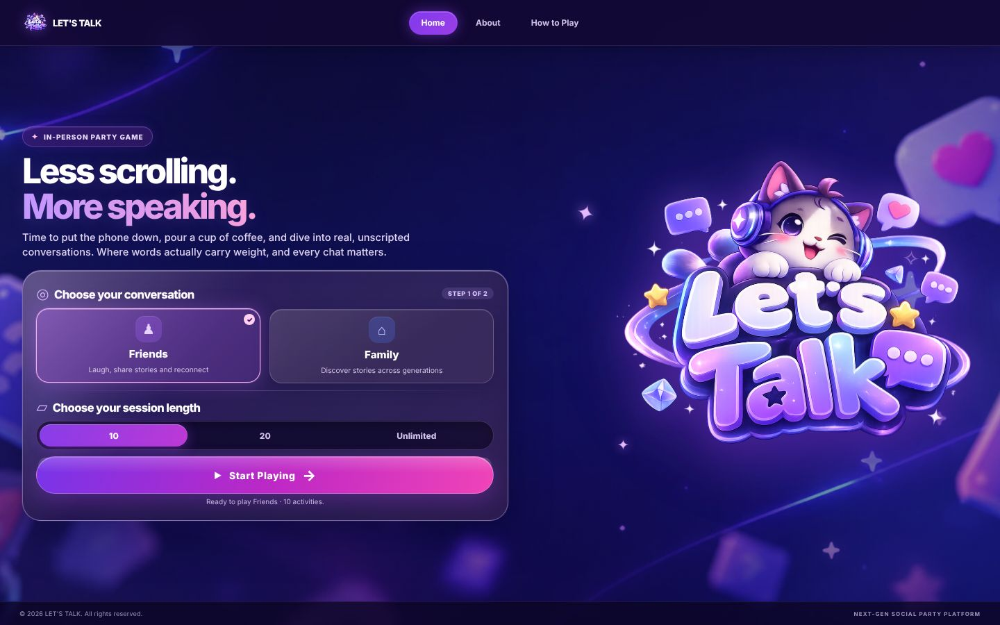 |  |  |
| **Pick Your Fate** | **How to Play modal** | **Game Complete** |
| 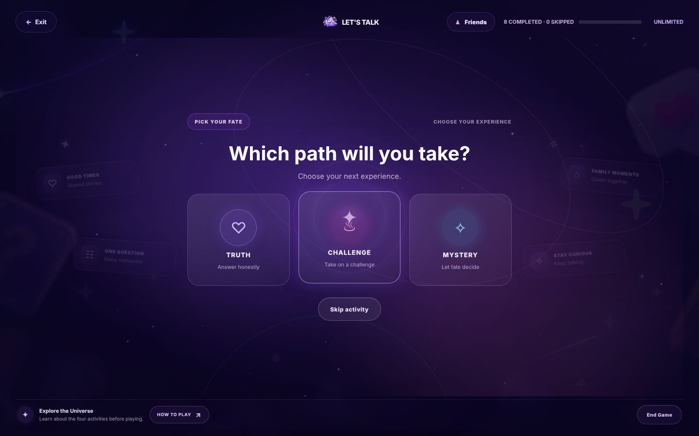 | 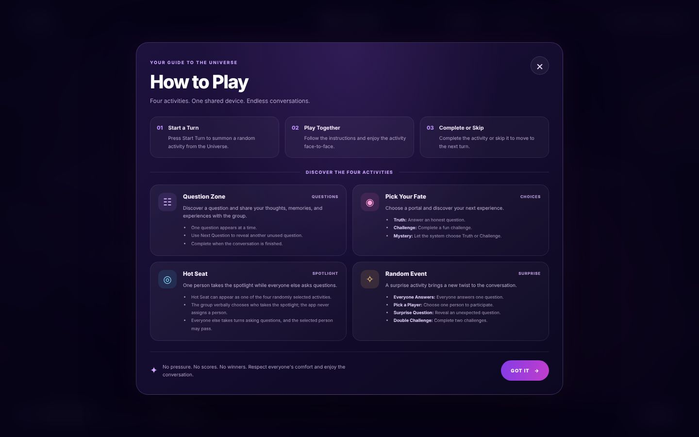 |  |

*Ảnh chụp từ bản chạy local (`npm run dev:frontend`). Nội dung câu hỏi lấy từ seed production `database/seeds/002_production_content.sql`.*

---

## Hướng Dẫn Cài Đặt và Chạy Ứng Dụng

### Yêu cầu hệ thống

| Công cụ | Phiên bản |
|---|---|
| Node.js | ≥ 20 |
| npm | ≥ 10 |
| Supabase project (PostgreSQL 15+) | Free tier là đủ |
| Trình duyệt | Chrome / Edge / Firefox / Safari bản mới |

### Các bước cài đặt

```bash
# 1. Clone repository
git clone https://github.com/nguyenbaphat59-del/Let-s-Talk-project.git
cd Let-s-Talk-project

# 2. Cài dependencies (npm workspaces: root + backend)
npm install

# 3. Cấu hình môi trường
cp .env.example .env
#    Điền SUPABASE_URL, SUPABASE_PUBLISHABLE_KEY (publishable/anon, KHÔNG dùng secret key)
#    ALLOWED_ORIGIN=http://localhost:5500,http://127.0.0.1:5500
#    SENTRY_DSN= (tuỳ chọn)

# 4. Khởi tạo database (Supabase → SQL Editor, chạy theo thứ tự)
#    database/schema.sql
#    database/seeds/001_reference_data.sql
#    database/seeds/002_production_content.sql
#    Kiểm tra: database/validation/validate_inventory.sql, security_check.sql
npm --workspace @lets-talk/backend run db:check   # xác nhận 880 nội dung, quyền read-only

# 5. Chạy ứng dụng (2 terminal)
npm run dev:backend    # http://localhost:1702/api/v1/health
npm run dev:frontend   # http://localhost:5500
```

**Ghi chú**

- Khi Frontend chạy ở cổng 5500, `frontend/js/api.js` tự gọi `http://localhost:1702/api/v1`. Bản production gọi Backend trên Render.
- Google Analytics và Sentry bật bằng cách điền ID vào `frontend/js/config.js` và `SENTRY_DSN` (xem [`docs/11_Monitoring_and_Analytics.md`](docs/11_Monitoring_and_Analytics.md)).
- Kiểm tra toàn bộ: `npm run check` (cú pháp, test, validators).

---

## Task 1: Project Planning & Teamwork

### (a) Phân công vai trò

Nhóm họp và thống nhất 4 vai trò, ma trận RACI và quyền sở hữu từng thư mục:

| Thành viên | Vai trò | Phụ trách chính |
|---|---|---|
| M1 Nguyễn Thành Long | Leader / PM & Docs | Đặc tả (PRD, kiến trúc), kế hoạch, GitHub workflow, README, điều phối peer review, video |
| M2 Võ Duy Anh | Frontend | Wireframe, 5 trang HTML/CSS, responsive, tương tác JS |
| M3 Nguyễn Bá Phát | Backend & Database | Schema/ERD, seed 880 nội dung, Express API, tích hợp, deploy Render |
| M4 Trần Văn Huy | QA, Optimization & Monitoring | Test, Lighthouse, GA4, Sentry, kiểm thử đa thiết bị |

Chi tiết: [`docs/01_Team_Roles.md`](docs/01_Team_Roles.md).

### (b) Wireframe

- **Công cụ:** Figma — [link Figma]
- **Các trang đã thiết kế:**
  - [ ] Homepage + Game Setup
  - [ ] About
  - [ ] How to Play
  - [ ] Gameplay (idle, roulette, activity, các modal)
  - [ ] Game Complete
- **Ảnh xuất:** `docs/wireframes/` (checklist và quy ước đặt tên trong [`docs/wireframes/README.md`](docs/wireframes/README.md)).

### (c) Project Plan

| Milestone | Deadline | Trạng thái |
|---|---|---|
| Wireframe + Prototype 1 → 2 (giảng viên duyệt) | Tuần 1 | Đúng hạn |
| Setup GitHub + database schema | Tuần 1 | Đúng hạn |
| Giao diện cơ bản (5 trang, responsive) | Tuần 1–2 | Đúng hạn |
| Tích hợp database + API + trang động | Tuần 2 | Đúng hạn |
| Tối ưu & monitoring | Tuần 3 | Hoàn thành code; chờ điền GA ID / Sentry DSN |
| Peer review | Tuần 3 — [DD/MM] | [Trạng thái] |
| Nộp bài | [DD/MM/YYYY] | [Trạng thái] |

Scope, deliverables, phân công chi tiết theo issue và rủi ro: [`docs/02_Project_Plan.md`](docs/02_Project_Plan.md).

### (d) GitHub Repository

https://github.com/nguyenbaphat59-del/Let-s-Talk-project

### (e) GitHub Workflow

- **Luồng:** Issue → branch `<loại>/<issue>-<mô-tả>` (`feature/`, `fix/`, `perf/`, `docs/`, `test/`, `chore/`) → commit → Pull Request có ≥ 1 reviewer → merge vào `main`. Chi tiết trong [`CONTRIBUTING.md`](CONTRIBUTING.md), kèm PR/Issue templates trong `.github/`.
- **Commit message:** Conventional Commits `type(scope): mô tả (#issue)`. Ví dụ trong repo:

```text
feat(frontend): integrate frontend with backend API
fix(backend): allow configured CORS origins in production
perf(frontend): load fonts asynchronously and prioritise the LCP image
feat(backend): optional Sentry error monitoring and structured request logs
docs(optimization): record Lighthouse fixes and before/after re-run
```

- **Pull Request & issue:** PR tham chiếu issue bằng `Closes #n`. Các PR đã merge: #2 (`test-backend`), #3 (`integration/laptop-sync`). Backlog tuần 3 được tạo bằng `tools/github/create-issues.sh`.
- **Screenshot commit list / PR:** [chèn ảnh `docs/screenshots/github-commits.png`]

---

## Task 2: Implement User Interface

### (a) Các trang đã xây dựng

| Trang | URL/Route | Mô tả | Người thực hiện |
|---|---|---|---|
| Homepage + Game Setup | `/index.html` | Hero, chọn chủ đề và độ dài, kiểm tra kho nội dung qua API, bắt đầu game | M2 (UI), M3 (tích hợp API) |
| About | `/about.html` | Câu chuyện và sứ mệnh của dự án, CTA về Game Setup | M2 |
| How to Play | `/how-to-play.html` | 3 bước chơi, giải thích 4 hoạt động và các nút điều khiển | M2 |
| Gameplay | `/gameplay.html` | Intro, roulette, 4 hoạt động, tiến độ, modal Exit / End / Rules | M2 (UI), M3 (logic API/session) |
| Game Complete | `/game-complete.html` | Kết thúc phiên, Play Again / Back to Home | M2, M3 |

Điều hướng: header (Home · About · How to Play) trên các trang nội dung. Gameplay có Exit / End Game kèm modal xác nhận. Từ trang Complete có thể chơi lại hoặc về Home.

| Home | About | How to Play |
|---|---|---|
|  | 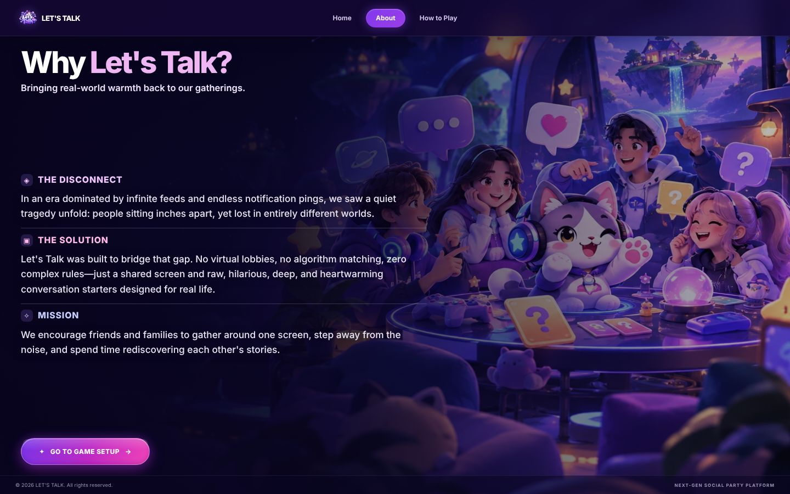 |  |

### (b) Sử dụng Tailwind CSS

**Không sử dụng Tailwind CSS.** Giao diện đã được giảng viên duyệt ở Prototype 2 được xây bằng CSS thuần, có hệ thống design token riêng (`:root` custom properties cho màu, bán kính, shadow, chiều cao header/footer), component class (`.btn`, `.glass-panel`, `.topic-card`, …) và hơn 40 media query cho các breakpoint 390 / 600 / 768 / 1024 px. Nhóm quyết định không chuyển sang Tailwind ở giai đoạn cuối để tránh làm thay đổi giao diện đã duyệt. Design system được mô tả trong [`docs/DESIGN-SYSTEM.md`](docs/DESIGN-SYSTEM.md).

### (c) Các tính năng tương tác

| Tính năng | Mô tả | File/Component | Người thực hiện |
|---|---|---|---|
| Chọn chủ đề / độ dài | Toggle có `aria-pressed`, ghi nhớ lựa chọn, phản hồi trạng thái qua `aria-live` | `homepage.js` | M2 |
| Kiểm tra trước khi bắt đầu | Gọi catalog API, khoá nút khi đang tải, báo lỗi nếu chủ đề hết nội dung hoặc mất mạng | `homepage.js`, `api.js` | M3 |
| Cinematic intro | Hiệu ứng mở đầu nhiều lớp, có nút Skip | `gameplay.html`, `gameplay.js` | M2 |
| Roulette chọn hoạt động | Hiệu ứng quay dừng ở hoạt động do server chọn | `gameplay.js` | M2 |
| Pick Your Fate | 3 cổng Truth / Challenge / Mystery, tự vô hiệu hoá cổng hết nội dung | `gameplay.js` | M2, M3 |
| Next Question | Đổi câu hỏi (animation shuffle), không tăng tiến độ | `gameplay.js` | M2 |
| Complete / Skip / Pass + progress | Cập nhật thanh tiến độ và bộ đếm; kết thúc khi đạt 10/20 | `gameplay.js`, `session.js` | M2, M3 |
| Modal Exit / End Game / How to Play | Hộp thoại xác nhận (`role="dialog"`), đóng bằng Esc hoặc click nền | `gameplay.html`, `gameplay.js` | M2 |
| Khôi phục phiên | Tải lại trang vẫn giữ nguyên lượt hiện tại (Local Storage v2, có kiểm tra dữ liệu bị sửa) | `session.js`, `storage.js` | M3 |
| Thông báo lỗi | Lỗi mạng, hết nội dung và phiên hỏng đều có thông báo dễ hiểu | `gameplay.js`, `homepage.js` | M2, M3 |

**Kiểm thử:** `frontend/test/session.test.js` và `api.test.js` (session, chống lặp, khôi phục, xử lý lỗi), cùng kiểm thử thủ công trên 3 kích thước màn hình. Một lượt chơi đầu-cuối (setup → intro → 4 loại hoạt động → End Game → Complete) được chạy tự động bằng Playwright và không có lỗi console.

| Intro | Rules modal | End Game modal |
|---|---|---|
| 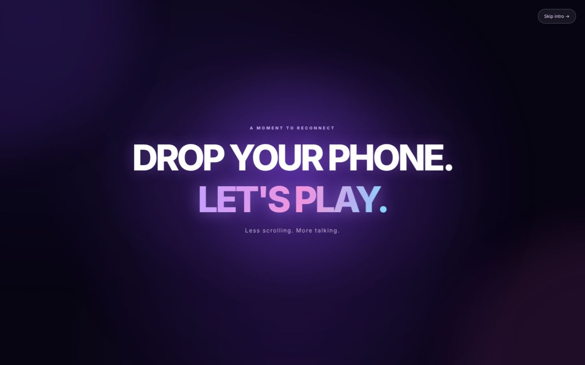 |  | 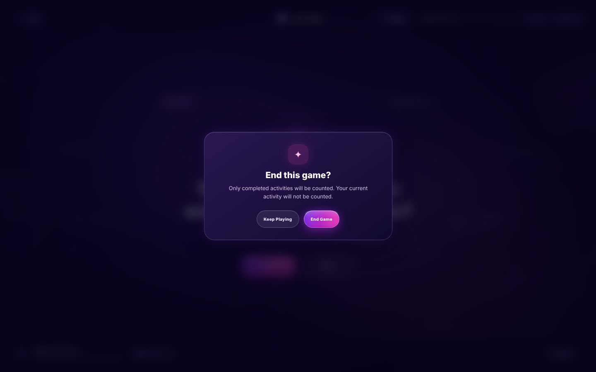 |

### (d) Giao diện trên nhiều thiết bị

- [x] Mobile (< 768px) — kiểm tra ở 320, 375, 390, 414 px
- [x] Tablet (768px – 1024px) — 768, 820, 1023 px
- [x] Desktop (> 1024px) — 1024, 1280, 1440, 1920 px (kể cả màn hình thấp và landscape)

| Mobile (390px) | Tablet (820px) | Desktop (1440px) |
|---|---|---|
| 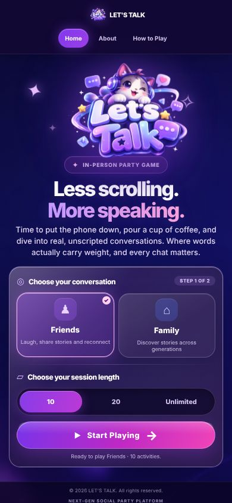 |  |  |
|  |  |  |

---

## Task 3: Database Integration & Dynamic Content

### (a) Thiết kế cơ sở dữ liệu

- **Hệ quản trị:** PostgreSQL (Supabase)
- **Số bảng:** 5 · **Dữ liệu:** 2 topics, 4 gameplay modes, 16 content groups, 18 allowed-type mappings, 880 content items

| Bảng | Mô tả | Các cột chính |
|---|---|---|
| `topics` | Chủ đề chơi (Friends, Family) | `id` PK, `code` UNIQUE, `name`, `is_active` |
| `gameplay_modes` | 4 nhóm hoạt động | `id` PK, `code` UNIQUE, `name`, `display_order` |
| `content_groups` | Kho nội dung theo chủ đề × hoạt động (vd. `truth`, `double_challenge`) | `id` PK, `topic_id` FK, `gameplay_mode_id` FK, `code`, `is_active` |
| `content_group_allowed_types` | Loại nội dung hợp lệ của từng kho (`question` / `challenge`) | (`content_group_id` FK, `content_type`) PK |
| `content_items` | 880 câu hỏi / thử thách | `id` PK (UUID), (`content_group_id`, `content_type`) FK, `content_text`, `is_active` |

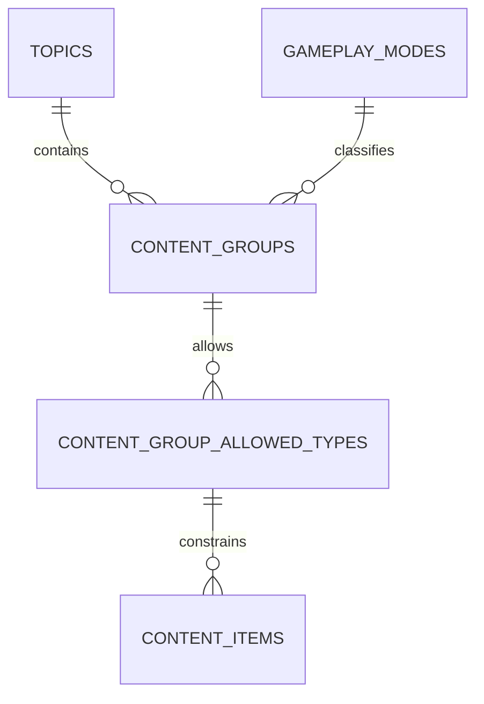

ERD đầy đủ (kèm kiểu dữ liệu, ràng buộc, RLS): [`docs/03_Database_Schema.md`](docs/03_Database_Schema.md) · SQL: [`database/schema.sql`](database/schema.sql).

### (b) Kết nối cơ sở dữ liệu

- **Server-side:** Node.js 20 + Express 5
- **Phương thức:** RESTful API `/api/v1` (OpenAPI 3.1: [`docs/openapi.yaml`](docs/openapi.yaml)). Backend dùng `@supabase/supabase-js` với publishable key.
- **CRUD:**
  - [ ] Create
  - [x] Read
  - [ ] Update
  - [ ] Delete

  Đây là quyết định thiết kế có chủ đích (PRD, Solution Architecture). Ứng dụng không có tài khoản người dùng, và phiên chơi được lưu ở Local Storage của trình duyệt. Vì vậy runtime chỉ cần **đọc** nội dung. Supabase RLS chỉ cấp quyền SELECT cho role `anon`, còn INSERT/UPDATE/DELETE bị chặn trên cả 5 bảng (`database/validation/security_check.sql`). Nhờ đó khoá dùng ở server không thể sửa nội dung. Việc tạo/sửa/xoá nội dung do nhóm thực hiện qua SQL seed/migration có kiểm soát phiên bản (`database/seeds/`).
- **Kiến trúc:**

```text
Browser (HTML/CSS/JS, Local Storage session)
   │  fetch JSON  (CORS allowlist, rate limit 60 req/phút cho gameplay)
   ▼
Express API (Render)  — validate input → GameplayService (chọn ngẫu nhiên an toàn, chống lặp)
   │  @supabase/supabase-js (publishable key, SELECT only)
   ▼
Supabase PostgreSQL (5 bảng, RLS)
```

### (c) Các trang hiển thị dữ liệu động

| Trang | Dữ liệu hiển thị | Query/Endpoint | Người thực hiện |
|---|---|---|---|
| Home (Game Setup) | Tên chủ đề và số nội dung còn khả dụng của 9 kho. Chặn bắt đầu nếu kho rỗng. | `GET /api/v1/topics/:topicCode/catalog` | M3 |
| Gameplay | Hoạt động do server chọn và câu hỏi/thử thách tương ứng, lọc theo chủ đề và các ID đã dùng | `POST /api/v1/gameplay/next-activity`, `/resolve-fate`, `/question-zone/next` | M3 |
| Game Complete | Play Again tải lại catalog của chủ đề vừa chơi để tạo phiên mới | `GET /api/v1/topics/:topicCode/catalog` | M3 |

Dữ liệu thay đổi theo lựa chọn của người dùng (chủ đề, Truth/Challenge/Mystery) và theo các ID đã dùng trong phiên. Phần kiểm thử gồm 41 test Backend (service, repository, HTTP integration) và `npm run db:check` (đối chiếu đúng 880 nội dung trên Supabase thật).

| Gameplay — Question Zone (mobile) | Gameplay — Hot Seat (desktop) |
|---|---|
|  |  |

---

## Task 4: Optimization

### (a) Lighthouse performance check

**Trước khi tối ưu** (Chrome DevTools, 21/11/2026, `localhost:5500`, trang Home):

| Chỉ số | Desktop | Mobile |
|---|---|---|
| Performance | 94 | 71 |
| Accessibility | 100 | 100 |
| Best Practices | 100 | 100 |
| SEO | 100 | 100 |


**Các vấn đề và cách khắc phục:**

| Vấn đề | Hành động khắc phục |
|---|---|
| Render-blocking: stylesheet Google Fonts chặn lần vẽ đầu | Preload + áp dụng bất đồng bộ (`media="print" onload`), có `<noscript>` fallback |
| Ảnh không khai báo `width`/`height` | Thêm kích thước gốc `1200×957` cho logo; CSS vẫn quyết định kích thước hiển thị nên layout không đổi |
| LCP request discovery (thiếu `fetchpriority=high`) | `<link rel="preload" as="image" fetchpriority="high">` cho ảnh LCP |
| Script analytics/monitoring có thể làm chậm tải | `gtag.js` chỉ tải sau sự kiện `load`; Sentry Loader là script nhỏ, bất đồng bộ; mọi script dùng `defer` |
| Improve image delivery (~1 MB logo PNG) | **Chưa xử lý.** Nhóm quyết định không thay đổi file ảnh trong đợt này (xem hạn chế bên dưới) |

**Sau khi tối ưu** (đo lại cùng phương pháp, Lighthouse 13 headless, `bash tools/lighthouse-audit.sh`):

| Trang / thiết bị | Performance trước → sau | FCP trước → sau | Accessibility | Best Practices | SEO |
|---|---|---|---|---|---|
| Home — Mobile | 75 → 76 | 1.5 s → 1.3 s | 100 | 100 | 100 |
| Home — Desktop | 96 → 96 | 0.4 s → 0.3 s | 100 | 100 | 100 |
| About — Mobile | 100 → 100 | 1.5 s → 1.3 s | 100 | 100 | 100 |
| How to Play — Mobile | 99 → 100 | 1.6 s → 1.3 s | 100 | 100 | 100 |

Ba audit (unsized images, LCP discovery, render-blocking fonts) chuyển từ *failed* sang *passed*. FCP giảm khoảng 0.2–0.3 s trên mọi trang. Hạn chế còn lại: LCP mobile của trang Home vẫn khoảng 7.9 s vì phần tử LCP là `lets-talk-logo.png` dung lượng 1 MB. Muốn Performance mobile vượt 90 thì cần thêm một bản WebP đã nén. Báo cáo HTML đầy đủ ở [`docs/optimization/lighthouse/reports/`](docs/optimization/lighthouse/reports/), phân tích ở [`docs/optimization/lighthouse/README.md`](docs/optimization/lighthouse/README.md) §10. Bằng chứng sau tối ưu là các báo cáo Lighthouse HTML đầy đủ (mở được bằng trình duyệt) trong thư mục trên.

### (b) Error and user-behavior monitoring

**Google Analytics**

- [x] Đã tích hợp GA4 (`frontend/js/analytics.js`, tải sau `load`, tắt trên localhost)
- **Measurement ID:** `G-187Q24EEMY` (web data stream `1638866491`, cấu hình trong `frontend/js/config.js`)
- **Tích hợp:** `page_view` tự động, cộng với 17 sự kiện gameplay (`game_start`, `activity_drawn` theo `activity_family`, `fate_choice`, `activity_complete`/`activity_skip`, `game_complete`, `api_error`, …) lấy từ ID nút và kết quả API, không sửa logic game và không gửi dữ liệu cá nhân.
- **Screenshot dashboard (GA Realtime):**

  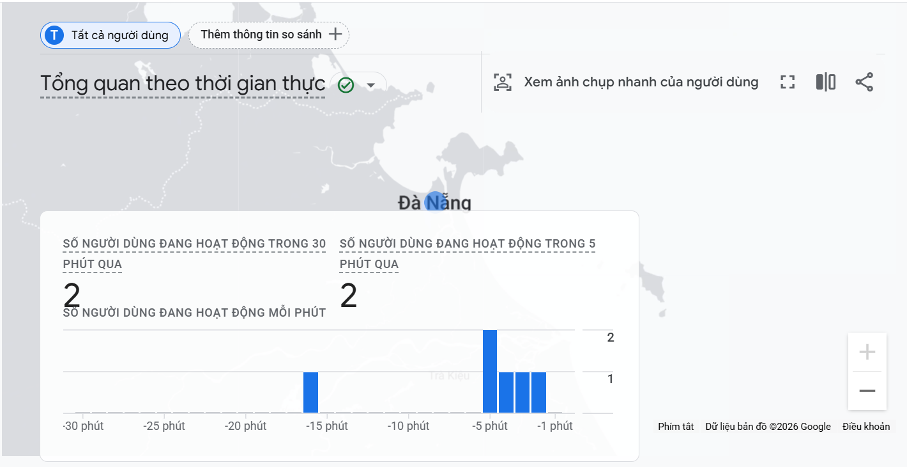

**Sentry**

- [x] Đã tích hợp Sentry — Frontend (Loader Script) và Backend (`@sentry/node`)
- **DSN / cấu hình:** Frontend `LT_CONFIG.sentryDsn` · Backend biến môi trường `SENTRY_DSN` (tuỳ chọn, được kiểm tra khi khởi động)
- **Loại lỗi được theo dõi:**
  - Frontend: uncaught exception, unhandled promise rejection (kể cả lỗi xảy ra trước khi SDK tải xong), lỗi API (mất mạng, 5xx, response không đọc được, mã 4xx bất thường) kèm `endpoint`, `status`, `code` và `requestId`
  - Backend: mọi lỗi 500 và `ApiError` ≥ 500 (ví dụ Supabase không truy cập được), gắn tag `request_id`, `http.method`, `http.path`
  - Log: mỗi request ghi một dòng JSON (`time, level, requestId, method, path, status, durationMs`). Cùng một `requestId` xuất hiện ở response, Sentry và Render logs nên có thể truy vết một lỗi từ đầu đến cuối.
- **Screenshot / error log:** log khởi động Backend trên Render xác nhận Sentry đã bật; ảnh Console khi gửi lỗi thử ở Frontend.

  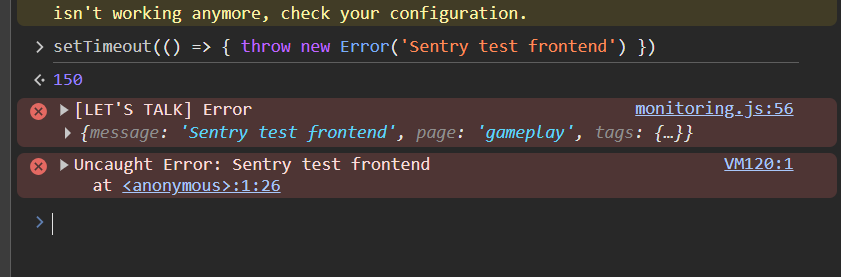

  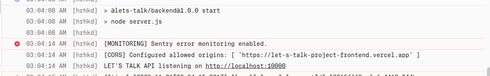

Chi tiết và cách kiểm chứng: [`docs/11_Monitoring_and_Analytics.md`](docs/11_Monitoring_and_Analytics.md).

---

## Task 5: UI/UX Peer Review & Evaluation

### (a) Feedback cho nhóm khác

Toàn bộ bảng review (Usability, Aesthetics, User-Friendliness) và nội dung trao đổi nằm trong [`docs/peer-review/reviews-given.md`](docs/peer-review/reviews-given.md).

**Nhóm FocuSpace** (Phúc Thịnh, Tuấn Hưng, Đình Nhiên, Tuấn Lộc) — FocuSpace, phòng học ảo pixel art kèm nhạc Lo-fi · https://focuspace-iota.vercel.app

| Khía cạnh | Điểm mạnh | Gợi ý cải thiện |
|---|---|---|
| Usability | Trang chủ có 2 nút hành động rõ (“Vào phòng”, “Xem thư viện đồ vật”), vào phòng không cần tài khoản. Đồng hồ Pomodoro 25:00 kèm nút “Bắt đầu” nằm cố định góc phải, luôn nhìn thấy khi học. Có ô thông báo ngắn (“2 nguồn âm đang hoạt động”) để biết trạng thái âm thanh. | Trên điện thoại dựng dọc, cả trang Căn phòng bị xoay 90° để thành màn ngang, người dùng phải tự nghiêng máy mà không có lời nhắc. Nên hiện thông báo “Xoay ngang để trải nghiệm tốt hơn” (có nút bỏ qua) hoặc làm bố cục dọc riêng. |
| Aesthetics | Pixel art đồng nhất từ logo, nút đến khung cảnh. Mỗi phòng có bảng màu riêng (phòng học nâu–cam, phòng ngủ tím, sân vườn xanh) nhưng vẫn cùng một phong cách. Nền tối hợp với nhạc Lo-fi và học buổi tối. | Thanh công cụ trong phòng chỉ có 3 biểu tượng pixel (nốt nhạc, đồ vật, loa). Tên của chúng chỉ hiện khi rê chuột nên trên điện thoại/máy tính bảng người dùng phải đoán. Nên thêm nhãn chữ ngắn dưới biểu tượng ở màn hình cảm ứng. |
| User-Friendliness | Trang Giới thiệu & Liên hệ có hướng dẫn dùng nhanh, email từng thành viên. Trang chủ nhắc đeo tai nghe để nghe rõ âm thanh trái/phải. Nút có trạng thái `aria-pressed` và nhãn cho trình đọc màn hình. | Trang Thống kê khi chưa đăng nhập chỉ có một dòng chữ và nút Đăng nhập. Nên cho xem biểu đồ mẫu để người dùng thấy lợi ích trước khi tạo tài khoản. Thẻ trong Thư viện hiển thị kích thước pixel (vd. `26×26`), thông tin này không có ý nghĩa với người dùng và có thể bỏ. |

**Nhóm PawPass** (Hữu Triết, Duy Huy, Thế Dũng, Thành Đạt, Duy Quang) — PawPass, sổ hộ chiếu thú cưng · https://pawpass-hosothucung-web.vercel.app

| Khía cạnh | Điểm mạnh | Gợi ý cải thiện |
|---|---|---|
| Usability | Form đăng nhập kiểm tra ngay khi bấm: mỗi ô có thông báo riêng bằng tiếng Việt (“Vui lòng nhập email.”, “Email không đúng định dạng.”) và viền đỏ, sửa xong ô nào thì lỗi ô đó biến mất. Các trang không bị tràn ngang trên điện thoại 390 px. | Trang đầu tiên là màn Đăng nhập. Trên điện thoại, phần giới thiệu sản phẩm bị ẩn, khách mới chỉ thấy form mà không biết PawPass làm gì. Nên để trang Giới thiệu làm trang đầu, hoặc thêm 1–2 câu và nút “Tìm hiểu thêm” phía trên form. Các link “Giới thiệu PawPass”, “Liên hệ”, “Đăng ký ngay” chỉ cao khoảng 21–23 px, khó bấm bằng ngón tay (khuyến nghị ≥ 44 px). |
| Aesthetics | Ý tưởng “hộ chiếu” được thể hiện nhất quán: khung viền nét đứt, con dấu “Đã tiêm · Mũi 2”, thẻ mẫu bé “Mochi”, minh hoạ chó mèo. Tông cam–kem ấm áp, hợp chủ đề thú cưng. | Trên máy tính, màn Đăng nhập có khoảng trống lớn phía dưới. Màn Đăng nhập dùng 2 link chữ thay vì thanh menu như trang Giới thiệu và Liên hệ (có logo + menu ☰), nên chuyển trang thấy không đồng bộ. |
| User-Friendliness | Trang Giới thiệu đi theo mạch dễ hiểu: vấn đề → tính năng → “Bắt đầu trong 3 bước”. Form Liên hệ có bộ đếm ký tự 0/1000, cảnh báo không ghi thông tin riêng tư, kèm FAQ dạng mở rộng. | Không có “Quên mật khẩu” và nút hiện/ẩn mật khẩu. Lời nhắn Liên hệ được gửi thành Issue công khai trên GitHub nên người không có tài khoản GitHub khó dùng; nên thêm email liên hệ. Có thể thêm tài khoản dùng thử để người xem trải nghiệm trước khi đăng ký. |

### (b) Xử lý feedback nhận được

| Feedback | Nguồn | Quyết định | Lý do/Commit |
|---|---|---|---|
| Giao diện Prototype 1 quá đơn giản, chưa hấp dẫn | Giảng viên | ✅ Đã thực hiện | Prototype 2 làm lại toàn bộ lớp hình ảnh (glass panel, gradient, mascot, animation) — `738ed76` |
| Gameplay đơn điệu, chưa đủ hứng thú | Giảng viên | ✅ Đã thực hiện | 4 nhóm hoạt động ngẫu nhiên, intro, roulette (PRD v1.4) — `738ed76`, `a6bc8c3` |
| [Feedback từ nhóm …] | [Nhóm] | [✅/❌] | [commit / lý do] |

Nhật ký đầy đủ và nguyên tắc ra quyết định: [`docs/peer-review/received-feedback.md`](docs/peer-review/received-feedback.md).

---

## Deliverables Checklist

- [ ] Source code trên GitHub (public hoặc đã share cho giảng viên), mọi branch đã merge qua PR
- [x] README.md có hướng dẫn cài đặt, tổng quan, danh sách tính năng kèm screenshot và ERD
- [ ] Video demo YouTube (≤ 10 phút, ≥ 720p, không để private)
- [ ] Self-report của từng thành viên đã commit vào `docs/self-reports/`

## Self-Reports

| Họ tên | Link Self-Report |
|---|---|
| Nguyễn Thành Long | [self-report-nguyen-thanh-long.md](docs/self-reports/self-report-nguyen-thanh-long.md) |
| Võ Duy Anh | [self-report-vo-duy-anh.md](docs/self-reports/self-report-vo-duy-anh.md) |
| Nguyễn Bá Phát | [self-report-nguyen-ba-phat.md](docs/self-reports/self-report-nguyen-ba-phat.md) |
| Trần Văn Huy | [self-report-tran-van-huy.md](docs/self-reports/self-report-tran-van-huy.md) |

---

## Phụ lục A — Tài liệu kỹ thuật

> Nội dung README kỹ thuật trước đây, giữ nguyên văn (chỉ hạ một cấp tiêu đề).

## LET'S TALK

LET'S TALK is an online party-game web application designed for friends and family physically together around one shared browser/device. “Face-to-face” describes the play context; the website itself is online-only.

### Current architecture

- **Frontend:** HTML, CSS, Vanilla JavaScript in `frontend/`.
- **Backend:** Node.js 20+ and Express 5 in `backend/`.
- **Database:** Supabase PostgreSQL, accessed read-only by the Backend through `@supabase/supabase-js`.
- **Session ownership:** Browser Local Storage schema v2. The Backend does not persist sessions, players, turn counts, or usage history.
- **API:** Stateless REST endpoints under `/api/v1`.
- **Content:** 880 production prompts across Friends and Family (640 questions + 240 challenges) stored in Supabase.
- **Prototype JSON:** `frontend/data/` is retained as reference/legacy sample data; production gameplay JavaScript no longer loads those JSON files.

### Project structure

```text
lets-talk/
├── frontend/
│   ├── index.html
│   ├── about.html
│   ├── how-to-play.html
│   ├── gameplay.html
│   ├── game-complete.html
│   ├── css/
│   ├── js/
│   │   ├── api.js
│   │   ├── storage.js
│   │   ├── session.js
│   │   ├── homepage.js
│   │   ├── gameplay.js
│   │   └── game-complete.js
│   ├── data/                 # prototype/reference only
│   ├── assets/images/
│   └── server.mjs            # local static preview only
├── backend/
│   ├── server.js             # Express entrypoint; default export for Vercel
│   ├── package.json
│   ├── README.md
│   ├── src/
│   │   ├── app.js
│   │   ├── config/
│   │   ├── errors/
│   │   ├── middlewares/
│   │   ├── repositories/
│   │   ├── routes/
│   │   ├── services/
│   │   └── utils/
│   └── test/
├── database/
├── docs/
├── tools/
├── .env.example
├── .gitignore
├── package.json
└── README.md
```

### Gameplay rules implemented by the API

- Automatic main families are Question Zone, Pick Your Fate, Random Event, and Hot Seat, selected uniformly among currently eligible families. When all four are eligible, each has a 25% probability.
- Hot Seat is part of the automatic roulette; the group verbally chooses the participant and the participant may pass.
- Truth and Challenge use independent pools. Mystery is a secure 50/50 choice only when both pools have remaining content.
- Random Event selects uniformly among eligible subtypes. Double Challenge requires two distinct unused prompts. Pick a Player is available only when both its Question and Challenge pools remain, and its type is selected 50/50; the group chooses the participant verbally.
- Used IDs are validated against the selected topic, group, and content type. No silent pool substitution or reuse is allowed.
- Complete increments Completed and Processed. Skip and Hot Seat Pass increment Skipped and Processed. Next Question consumes another Question Zone item but does not advance progression.
- Finite sessions end only when 10 or 20 activities have been completed. Unlimited ends on full content exhaustion or End Game.

### Local setup

Requirements: Node.js 20+ and npm.

1. Copy `.env.example` to `.env` at the repository root.
2. Set your Supabase project URL and **publishable** key:
   - `SUPABASE_URL`
   - `SUPABASE_PUBLISHABLE_KEY`
3. For local development, keep `ALLOWED_ORIGIN` set to the exact Frontend origin(s), such as `http://localhost:5500,http://127.0.0.1:5500`.
4. Install workspace dependencies:

   ```bash
   npm install
   ```

5. Start the Backend in Terminal 1:

   ```bash
   npm run dev:backend
   ```

6. Start the Frontend in Terminal 2:

   ```bash
   npm run dev:frontend
   ```

7. Open `http://localhost:5500`.

The Frontend development API client routes requests to `http://localhost:1702/api/v1` when the site is served on port 5500. For another development port or API host, set `window.LT_API_BASE_URL` before the application scripts load.

### API endpoints

- `GET /api/v1/health`
- `GET /api/v1/topics`
- `GET /api/v1/topics/:topicCode/catalog`
- `POST /api/v1/gameplay/next-activity`
- `POST /api/v1/gameplay/resolve-fate`
- `POST /api/v1/gameplay/question-zone/next`

See `docs/04_API_Documentation.md` and `docs/openapi.yaml` for the full contract.

The Member 3 implementation and verification summary is in `docs/09_STEP3_BACKEND_COMPLETION_REPORT.md`; the file-by-file change inventory is in `docs/10_STEP3_CHANGED_FILES.md`.

### Validation and tests

From the repository root:

```bash
npm test                 # full suite, including Express HTTP integration tests
npm run test:offline     # dependency-free service/session/API-client test subset
npm run validate
npm run validate:step2
npm run validate:backend
npm run check            # full check, requires npm install
npm run check:offline    # static checks + dependency-free tests
```

The Backend service, repository, configuration, Frontend API-client, and Local Storage session tests use deterministic mocks and do not require a production Supabase connection. The HTTP integration tests exercise the real Express app and require the dependencies installed by `npm install`. A live Supabase readiness check requires your own `.env` values. Run `npm --workspace @lets-talk/backend run db:check` to verify the read-only connection and exact inventory. No credentials are included in this ZIP. Never paste Supabase credentials into chat or commit `.env`.

### Database

Supabase contains five approved tables:

1. `topics`
2. `gameplay_modes`
3. `content_groups`
4. `content_group_allowed_types`
5. `content_items`

Expected production inventory: 2 topics, 4 gameplay modes, 16 groups, 18 allowed-type mappings, 880 active content items. The application runtime performs SELECT operations only using the publishable key and the existing `anon`-scoped RLS policies. Do not use or introduce a service-role/secret key.

### Deployment status and Vercel

`backend/server.js` exports the Express app for the Vercel Express runtime. The originally selected Frontend/Backend Vercel Services topology is conditional: Vercel documents Services as Private Beta with access by request. Before treating deployment as complete, verify the account has access, confirm service roots and routing, and test `/api/v1/health` in a Preview deployment. The Backend already retains `/api/v1` in its route path; do not strip `/api` at the service boundary.

If Services access is unavailable, use a separately deployed Express service and configure a deliberate API base URL or select another host topology. Do not add an unverified rewrite file.

### Security baseline

- Never commit `.env`.
- Never put Supabase keys in browser JavaScript.
- Runtime uses only the Supabase publishable key and existing read-only RLS grants.
- JSON body limit is 128 KB.
- Gameplay endpoints are rate-limited.
- Every used content ID is a unique UUID validated against its declared active pool.
- Database errors, credentials, and stack traces are not returned to API clients.
