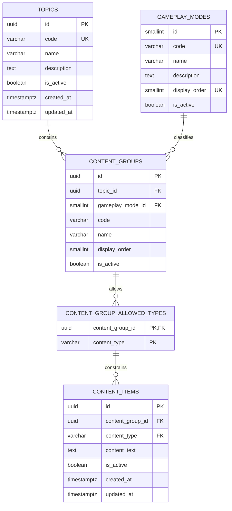

# LET'S TALK — Database Schema and ERD

**Document version:** 1.1.0  
**Target:** Supabase PostgreSQL  
**Status:** Schema, reference data, and production content deployed; inventory and read-only policy checks verified by the project owner on 21 November 2026.  
**Source SQL:** `database/schema.sql`, `database/seeds/001_reference_data.sql`, `database/seeds/002_production_content.sql`.

## 1. Database responsibilities and exclusions

Supabase stores reusable product catalog/content. It does not store active game sessions, player identities, turn counters, completion/skipped counts, content usage history, game history, or admin records. Active session state and used content IDs stay in the browser’s Local Storage.

Only five core tables are approved. Do not add a `players`, `users`, `game_sessions`, `session_history`, `used_content`, or `session_content_items` table for the current release.

## 2. ERD

## 3. Tables and columns

### 3.1 `topics`

| Column | Type | Rule / purpose |
|---|---|---|
| `id` | UUID | Primary key; default `gen_random_uuid()` |
| `code` | VARCHAR(30) | Unique; CHECK permits `friends`, `family` only |
| `name` | VARCHAR(80) | Required, nonblank |
| `description` | TEXT | Optional explanatory description |
| `is_active` | BOOLEAN | Required; default true; catalog visibility |
| `created_at` | TIMESTAMPTZ | Default now |
| `updated_at` | TIMESTAMPTZ | Default now; trigger updates on change |

Rows: 2 (`friends`, `family`). There is no `love` topic in the approved scope.

### 3.2 `gameplay_modes`

| Column | Type | Rule / purpose |
|---|---|---|
| `id` | SMALLINT | Stable primary key, fixed IDs 1–4 |
| `code` | VARCHAR(40) | Unique; ID/code pair is constrained |
| `name` | VARCHAR(80) | Required, nonblank |
| `description` | TEXT | Optional |
| `display_order` | SMALLINT | Unique, 1–4 |
| `is_active` | BOOLEAN | Default true |

Stable mapping:

| ID | Code | Meaning |
|---:|---|---|
| 1 | `question_zone` | Main automatic family |
| 2 | `pick_your_fate` | Truth and Challenge selection family |
| 3 | `random_event` | Four Random Event sub-activities |
| 4 | `hot_seat` | Fourth automatic main activity family |

The Hot Seat gameplay-mode row maps to the existing `hot_seat` content group. No schema or seed change is required for automatic selection.

### 3.3 `content_groups`

| Column | Type | Rule / purpose |
|---|---|---|
| `id` | UUID | Primary key; fixed seed UUIDs currently used |
| `topic_id` | UUID | FK to `topics.id`, ON DELETE RESTRICT |
| `gameplay_mode_id` | SMALLINT | FK to `gameplay_modes.id`, ON DELETE RESTRICT |
| `code` | VARCHAR(50) | One of the 8 approved codes |
| `name` | VARCHAR(100) | Required, nonblank |
| `display_order` | SMALLINT | 1–8 within a topic |
| `is_active` | BOOLEAN | Default true |

Unique constraints: `(topic_id, code)` and `(topic_id, display_order)`. A trigger validates the code-to-mode mapping:

| Content group code | Required mode ID |
|---|---:|
| `question_zone` | 1 |
| `truth` | 2 |
| `challenge` | 2 |
| `double_challenge` | 3 |
| `everyone_answers` | 3 |
| `surprise_question` | 3 |
| `pick_a_player` | 3 |
| `hot_seat` | 4 |

There are 8 groups per topic, 16 total.

### 3.4 `content_group_allowed_types`

| Column | Type | Rule / purpose |
|---|---|---|
| `content_group_id` | UUID | FK to `content_groups.id` |
| `content_type` | VARCHAR(20) | CHECK: `question` or `challenge` |

Composite primary key: `(content_group_id, content_type)`. A trigger validates that the group code accepts that type. Only `pick_a_player` permits both types. There are 9 mappings per topic, 18 total.

### 3.5 `content_items`

| Column | Type | Rule / purpose |
|---|---|---|
| `id` | UUID | Primary key; deterministic UUIDs in production seed |
| `content_group_id` | UUID | Composite FK member to allowed type row |
| `content_type` | VARCHAR(20) | `question` or `challenge`; constrained by composite FK |
| `content_text` | TEXT | Required, nonblank prompt text |
| `is_active` | BOOLEAN | Default true; global content availability flag |
| `created_at` | TIMESTAMPTZ | Default now |
| `updated_at` | TIMESTAMPTZ | Default now; trigger updates on change |

The composite FK `(content_group_id, content_type)` to `content_group_allowed_types` prevents an item from using a type that its group does not allow. Do not add topic ID redundantly to this table; the topic is derived through the group relationship.

## 4. Approved content inventory

| Topic | Group | Type | Expected active items |
|---|---|---|---:|
| Friends | Question Zone | question | 100 |
| Friends | Truth | question | 50 |
| Friends | Challenge | challenge | 50 |
| Friends | Double Challenge | challenge | 50 |
| Friends | Everyone Answers | question | 50 |
| Friends | Surprise Question | question | 50 |
| Friends | Pick a Player | question | 20 |
| Friends | Pick a Player | challenge | 20 |
| Friends | Hot Seat | question | 50 |
| Family | Question Zone | question | 100 |
| Family | Truth | question | 50 |
| Family | Challenge | challenge | 50 |
| Family | Double Challenge | challenge | 50 |
| Family | Everyone Answers | question | 50 |
| Family | Surprise Question | question | 50 |
| Family | Pick a Player | question | 20 |
| Family | Pick a Player | challenge | 20 |
| Family | Hot Seat | question | 50 |

Totals: 880 active items = 640 questions + 240 challenges; Friends 440 and Family 440.

## 5. Indexes, functions, triggers

Additional indexes in `schema.sql`:

- `idx_content_groups_gameplay_mode` on `content_groups(gameplay_mode_id)`.
- `idx_content_items_active_group_type` partial index on `(content_group_id, content_type)` where `is_active = TRUE`.
- `uq_content_items_normalized_text` unique expression index on lowercase, whitespace-collapsed, trimmed Unicode NFC text. This prevents exact normalized prompt duplicates globally while preserving original display text.

Functions/triggers:

- `set_updated_at()` for `topics` and `content_items`.
- `validate_content_group_mode()` ensures group code and `gameplay_mode_id` match.
- `validate_content_group_allowed_type()` ensures group/type mapping is valid.
- `validate_existing_allowed_types_on_group_change()` prevents a group code change from invalidating existing allowed types.

Content should be retired by setting `is_active = FALSE`, not deleting rows. `is_active` is global availability, not “used in a game”. No `is_used`, `used_at`, or session columns are stored in the database.

## 6. RLS and grants

All five tables have Row Level Security enabled. Each has one permissive SELECT policy for role `anon`:

- Topics and gameplay modes: only active rows.
- Content groups: active group and active parent topic/mode.
- Allowed types: only mappings belonging to active groups.
- Content items: active item under active group, topic and gameplay mode.

The schema revokes public/anon/authenticated privileges on the five tables then grants SELECT to `anon`. Trigger functions are not callable by API roles. The intended runtime access is read-only.

### Live verification status (21 Nov 2026)

The project owner executed the schema and seed SQL in Supabase and shared query results confirming:

| Check | Observed result | Status |
|---|---:|---|
| Core tables | 5 | Verified |
| Topics | 2 | Verified |
| Gameplay modes | 4 | Verified |
| Content groups | 16 | Verified |
| Allowed-type mappings | 18 | Verified |
| Content items | 880 | Verified |
| Questions | 640 | Verified |
| Challenges | 240 | Verified |
| Group/type breakdown | 18 rows, exact counts | Verified |
| RLS enabled | true on all 5 | Verified |
| RLS policies | 1 SELECT policy/table, role anon | Verified |
| anon SELECT | true on all 5 | Verified |
| anon INSERT/UPDATE/DELETE | false on all 5 | Verified |

The repeatable `database/validation/validate_inventory.sql` script is included and should be run as a final release/CI database validation. The owner’s manual aggregate and group-by queries confirmed the displayed inventory; the full assertion script has not been confirmed as run. The Express API and a read-only Supabase inventory checker have since been implemented in Step 3. Live Data API connectivity and the strict SQL assertion script still require the owner's Supabase environment and have not been claimed as executed in this workspace.

## 7. SQL execution order and operations

Run only against a new/empty project or use a reviewed migration plan:

1. `database/schema.sql`
2. `database/seeds/001_reference_data.sql`
3. `database/seeds/002_production_content.sql`
4. `database/validation/validate_inventory.sql`

The current Supabase project has completed steps 1–3. Inventory is manually verified; step 4 is retained for repeatable strict validation.

Do not rerun schema over an unknown/modified database without reviewing effects. The seed scripts are designed to be re-runnable via `ON CONFLICT`, but any future data correction should be reviewed and versioned.

## 8. Change control

- Do not change table names, field names, IDs, group codes, or type mappings without updating the PRD, API contract, seed scripts, inventory validation, and Step 3 tests together.
- New topic requires product approval, a topic content plan, groups and content seed rows, RLS validation, and API catalog updates.
- Adding sessions/players/history is a scope change and requires new privacy/security/retention design.

**Database design v1.1.0 status: Deployed and verified for the current 880-item scope.**
