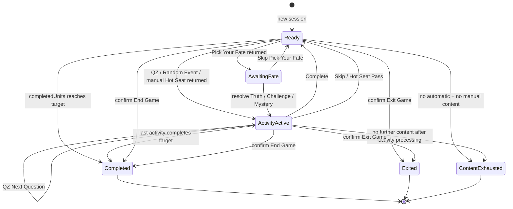

# LET'S TALK — Session Management Specification

**Version:** 1.0  
**Status:** Approved target specification for Step 3  
**Persistence owner:** Browser Local Storage  
**Database persistence:** None

## 1. Scope and ownership

The active game session is local to the shared browser/device. The Backend does not create a session row or remember turn progress. Supabase stores only reusable content/catalog records. This is intentional and keeps the current release account-free and single-device.

The Frontend owns:

- session creation and identity;
- selected topic and session length;
- current activity and current UI state;
- completed, skipped, and processed counters;
- used content IDs by dedicated pool;
- restoration, completion, early ending, and exit cleanup.

The Backend receives a used-ID snapshot on content-selection requests and validates it, but does not persist the session.

## 2. Local Storage keys

Recommended keys:

| Key | Purpose |
|---|---|
| `letsTalk.activeSession.v2` | Current active game session |
| `letsTalk.setupConfig.v1` | Last selected topic and session length |
| `letsTalk.lastResult.v1` | Small completion context needed for Play Again |

Do not store player names or sensitive personal data. The result record must not become a persistent game-history feature.

## 3. Session object schema

Target shape (JSON; fields are authoritative for the new implementation):

```json
{
  "schemaVersion": 2,
  "sessionId": "local-uuid",
  "topicCode": "friends",
  "sessionLength": 10,
  "progressionTarget": 10,
  "completedUnits": 0,
  "skippedUnits": 0,
  "processedTurns": 0,
  "gameStatus": "active",
  "currentState": "ready",
  "currentTurn": 1,
  "currentActivity": null,
  "usedContentIdsByPool": {
    "question_zone": [],
    "truth": [],
    "challenge": [],
    "double_challenge": [],
    "everyone_answers": [],
    "surprise_question": [],
    "pick_a_player_question": [],
    "pick_a_player_challenge": [],
    "hot_seat": []
  },
  "createdAt": "2026-11-21T00:00:00.000Z",
  "updatedAt": "2026-11-21T00:00:00.000Z"
}
```

### Field definitions

| Field | Type | Rule |
|---|---|---|
| `schemaVersion` | number | Must equal 2 for this target schema |
| `sessionId` | UUID/string | Unique local ID per new session |
| `topicCode` | enum | `friends` or `family` only |
| `sessionLength` | enum | `10`, `20`, or `unlimited` |
| `progressionTarget` | number/null | 10, 20, or null for Unlimited |
| `completedUnits` | integer | Starts at 0; increment only on Complete |
| `skippedUnits` | integer | Starts at 0; increment on Skip and Hot Seat Pass |
| `processedTurns` | integer | Starts at 0; increment on Complete/Skip; Next Question does not increment |
| `gameStatus` | enum | `active`, `completed`, `exited`, `content_exhausted` |
| `currentState` | enum | `ready`, `awaiting_fate`, `activity_active`, `exhausted` |
| `currentTurn` | integer | Display index; 1-based, equals `processedTurns + 1` before next completion attempt |
| `currentActivity` | object/null | Persist the current family, subtype, prompt(s), pool code, and IDs needed to restore the visible activity |
| `usedContentIdsByPool` | object | The nine arrays shown above; UUIDs cannot be repeated across arrays |
| `createdAt` / `updatedAt` | ISO timestamp | Client timestamps for local diagnostics |

`currentActivity` target shape:

```json
{
  "activityFamily": "random_event",
  "eventCode": "double_challenge",
  "content": [
    { "id": "uuid-1", "contentType": "challenge", "text": "..." },
    { "id": "uuid-2", "contentType": "challenge", "text": "..." }
  ],
  "usedPool": "double_challenge",
  "status": "active"
}
```

Persist returned text as part of the current activity so a refresh restores the same visible prompt rather than requesting another one. Used IDs are persisted before the prompt becomes interactable.

## 4. State transitions



`revealing`/roulette animation is a transient visual state and does not need to be persisted. Persist stable gameplay state (`ready`, `awaiting_fate`, `activity_active`, `completed`, `exhausted`). If a reload happens during animation, return to the stable state represented by the selected result.

## 5. Progress accounting

| User action | Completed | Skipped | Processed | Current activity |
|---|---:|---:|---:|---|
| Complete | +1 | 0 | +1 | Cleared after persist |
| Skip | 0 | +1 | +1 | Cleared after persist |
| Hot Seat Pass | 0 | +1 | +1 | Cleared after persist |
| QZ Next Question | 0 | 0 | 0 | Replaced; old and new QZ IDs remain used |
| End Game confirmed | No change | No change | No change | Not counted if incomplete |
| Exit Game confirmed | Session discarded | Session discarded | Session discarded | No completion record |

Finite progress percentage:

`completedUnits / progressionTarget * 100`

For a finite session, the interface should explicitly label `Completed 4 / 10`. Skipped and processed counts are separate. Do not display `0 / 10 TURNS` if the target is completed activity units.

Unlimited displays completed and skipped counts but no fixed target or percentage.

## 6. Content usage tracking

Track used IDs separately by pool. The mapping from API content to pool array is:

| Pool key | API/data group |
|---|---|
| `question_zone` | Question Zone question |
| `truth` | Truth question |
| `challenge` | Challenge challenge |
| `double_challenge` | Double Challenge challenge |
| `everyone_answers` | Everyone Answers question |
| `surprise_question` | Surprise Question question |
| `pick_a_player_question` | Pick a Player question |
| `pick_a_player_challenge` | Pick a Player challenge |
| `hot_seat` | Hot Seat question |

Double Challenge adds both IDs together. Pick a Player adds the ID to its resolved type-specific array. The application never uses one pool’s used IDs to select content from a different pool.

## 7. Persistence sequence and failure handling

For every new content response:

1. Validate response shape, topic, family/subtype, pool key, and content IDs.
2. Create a cloned candidate session object.
3. Add returned IDs to the correct pool(s), checking uniqueness.
4. Save the entire candidate session with one Local Storage write.
5. Only after the write succeeds, update in-memory session and display the prompt / enable Complete or Skip.

For Complete/Skip/Pass:

1. Lock action controls synchronously.
2. Clone session and compute counters.
3. Clear currentActivity from candidate state and derive next state.
4. If finite target reached, mark completed and save result/clear active record as one controlled transition.
5. Otherwise persist candidate session.
6. Update UI after persistence succeeds.

If Local Storage write fails, do not advance or display a success state. Show a clear error such as “Your game could not be saved in this browser. Free up storage or start a new game.” Avoid continuing with state that will be lost on refresh.

## 8. Restoration and version compatibility

On Gameplay load:

1. Read `letsTalk.activeSession.v2`.
2. Parse JSON inside try/catch.
3. Validate schemaVersion, enum values, counters, current state, pool keys, UUID formats, no cross-pool duplicate IDs, and current activity shape.
4. Restore the same current prompt and activity if valid.
5. If absent, return to Homepage/Game Setup.
6. If corrupt or unsupported, show a recovery message and offer an explicit Start New Game action; do not silently overwrite the saved object.

Prototype sessions are schemaVersion 1 and only contain the older question-sequence model. They cannot be safely converted to the multi-pool schema because their IDs/counters do not capture usage in the 9 new content pools. Do not auto-migrate v1 to v2. Ask the user to start a new session; only remove the legacy record after an explicit confirmation.

## 9. Completion, replay, and cleanup

- **Target reached:** persist final result, mark completion, clear active session, navigate to Game Completion.
- **End Game:** preserve already completed count in `lastResult`, do not count current incomplete activity, clear active session, navigate to Game Completion.
- **Content exhausted:** store reason `content_exhausted`, clear active session, navigate to the same Game Completion screen with truthful short subtitle.
- **Exit Game:** clear active and any transient intro handoff; return to Homepage; do not show completion.
- **Play Again:** use last result only to restore topic and sessionLength, revalidate catalog, create a new session ID, zero all counters, reset all used-ID arrays, and show the cinematic intro once.
- **Back to Home:** remove active session and completion context; return to Homepage.

The Game Completion page remains intentionally minimal and does not display session totals or a Choose Another Topic action.

## 10. Security and limitations

Local Storage is user-controlled. Validate IDs and structure before API calls, but do not claim anti-cheat or tamper-proof session tracking. Deliberate rollback of an earlier used-ID snapshot can cause reuse because there is no account or server-side session history in this release. This is a documented product trade-off, not a database defect.

**Session Management status: Complete for Step 2; implementation and migration tests are Step 3.**
