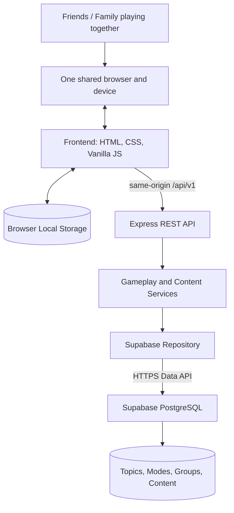

# LET'S TALK — Solution Architecture

**Version:** 1.3  
**Status:** Approved target architecture for Step 3 planning  
**Date:** 21 November 2026  
**Architecture style:** Three-tier application with a modular-monolith Backend  
**Requirements baseline:** `LETS_TALK_PRD.md` v1.3

> This is the target design. The current ZIP still contains a static frontend prototype, not the production Express API. Supabase schema and content have been deployed by the project owner and verified with SQL queries. No production API or Vercel deployment is claimed to exist yet.

## 1. Architecture goals and constraints

1. Preserve the current HTML/CSS/Vanilla JavaScript product interface and relative asset paths.
2. Add the missing Express Backend without converting the Frontend to React/Vue or another framework.
3. Store production topics and content in Supabase PostgreSQL.
4. Keep active session data and used-content tracking in browser Local Storage.
5. Keep the Backend stateless with respect to game sessions; it receives the browser's used-content snapshot on selection requests.
6. Use one GitHub repository and one Vercel Project with two Vercel Services (Frontend and Backend), subject to a deployment spike because Services is Beta.
7. Exclude player accounts, remote multiplayer, chat, realtime, scoring, player records, server-side session tables, and admin tools from the current release.

## 2. System context



The product is face-to-face and single-device, but the application is online-only. Content selection requires the Backend API. Local Storage maintains the current session, not the content database.

## 3. Technology decisions

| Layer | Decision | Reason / boundary |
|---|---|---|
| Frontend | HTML, CSS, Vanilla JavaScript | Preserve current prototype and avoid framework migration |
| Frontend hosting | Vercel Frontend Service | Static site served on the same project/domain |
| Backend | Node.js + Express | Modular monolith, REST JSON API |
| Backend hosting | Vercel Backend Service | Same domain and project; must prove Beta configuration |
| Database | Supabase PostgreSQL | User-selected managed Postgres and deployed schema |
| Database access | `@supabase/supabase-js` Data API | Avoid a direct Postgres connection pool in the initial serverless deployment |
| Session persistence | Browser Local Storage | Explicitly excludes server/database session persistence |
| Source control | One GitHub repository | One source of truth |
| Authentication | None in current release | Shared-device, public party game |
| Realtime | None | No remote collaboration or synchronization |

### 3.1 Supabase key model

Use `SUPABASE_URL` and `SUPABASE_PUBLISHABLE_KEY` in the Backend environment. The publishable key maps to the low-privilege `anon` role for unauthenticated requests; RLS and SQL grants restrict it to SELECT. Never ship a Supabase secret key in browser source. A secret key bypasses RLS and is not needed for the current content-read API.

Supabase documentation checked on 21 November 2026 states that legacy `anon`/`service_role` API keys are being deprecated by the end of 2026 and recommends the newer `sb_publishable_...` / `sb_secret_...` format. The publishable key maps to the low-privilege Postgres role `anon` for unauthenticated requests; the live SQL schema therefore continues to define the RLS policies and grants against the `anon` role. Do not confuse the API key label with the database role name.

### 3.2 Vercel Services decision and deployment spike

The selected deployment model is one Vercel Project containing:

- Frontend Service rooted at `frontend/`.
- Backend Service rooted at `backend/`, using Express.
- Root-level routing rewrites `/api/*` to Backend and all other paths to Frontend.

Vercel Services is Beta. The Vercel guide says Services can be configured within one project and routed by root-level rewrites. It also states the selected service receives the original request path; therefore Express must handle `/api/v1/...` rather than expecting the `/api` prefix to be stripped. This deployment decision is conditional on a minimal spike proving static output, Express entrypoint detection, rewrite routing, environment variables, logs, and preview deployment.

Candidate root-level `vercel.json` (validate in the spike; not claimed to be a proven drop-in config):

```json
{
  "$schema": "https://openapi.vercel.sh/vercel.json",
  "services": {
    "frontend": { "root": "frontend/" },
    "backend": {
      "root": "backend/",
      "framework": "express",
      "entrypoint": "server.js"
    }
  },
  "rewrites": [
    { "source": "/api/(.*)", "destination": { "service": "backend" } },
    { "source": "/(.*)", "destination": { "service": "frontend" } }
  ]
}
```

Project configuration must select the `Services` framework where required by the Vercel UI. Do not merge this config until the spike verifies the exact project behavior. If the Beta service topology cannot serve the static frontend reliably, return to architecture review rather than silently moving the Frontend into root `public/` or changing the product stack.

## 4. Component responsibilities

### 4.1 Frontend

- Render the five current pages/views and preserve the existing design system.
- Handle navigation, topic/session length selection, dialogs, animation, and accessibility.
- Show the roulette animation using the Backend-selected result; the UI must not choose a different result.
- Call relative `/api/v1/...` endpoints; never call Supabase directly.
- Maintain the active session in Local Storage, including current activity, counts, and used content IDs per pool.
- Restore and validate saved sessions; handle corrupted/old-version storage explicitly.
- Prevent double submission and only update the view after a valid activity result is persisted.

### 4.2 Backend

- Provide REST endpoints and normalized JSON responses.
- Validate topic codes, request shape, UUIDs, used-ID counts, and ID ownership.
- Read active content from Supabase through a repository layer.
- Select among eligible main families and sub-activities using secure server-side randomness.
- Enforce correct topic/group/type mapping and no reuse based on the supplied used-ID snapshot.
- Return explicit exhaustion and validation errors; never silently substitute a pool or reuse content.
- Remain stateless: no in-memory or database active-session record.

### 4.3 Database

Persistent catalog/content only: topics, gameplay modes, topic-specific content groups, allowed content types, and content items. RLS is enabled. Runtime access is read-only. No sessions, players, turn counters, or content-usage rows are stored.

## 5. Request/data flow

### 5.1 Initialization

1. Frontend validates topic and session length locally.
2. Frontend calls `GET /api/v1/topics/:topicCode/catalog`.
3. Backend checks that the topic is active and returns active pool counts/eligibility metadata.
4. Frontend initializes a new local session only when the response is valid and required core pools are present.
5. Save the session to Local Storage before navigating to Gameplay.

### 5.2 Automatic turn

1. Frontend sends topic code, trigger=`automatic`, and used content IDs by pool to `POST /api/v1/gameplay/next-activity`.
2. Backend checks current availability by dedicated content pool.
3. Backend uniformly selects among eligible automatic families: Question Zone, Pick Your Fate, Random Event. Hot Seat is deliberately excluded.
4. Backend returns either a QZ prompt, a Pick Your Fate choice state, or a resolved Random Event sub-activity and its prompt(s).
5. Frontend persists newly used IDs and the full current activity, then animates/reveals that exact selection.

### 5.3 Manual Hot Seat

Frontend sends trigger=`hot_seat_manual`. Backend checks the dedicated Hot Seat pool and returns one unused question. The application never chooses a participant.

### 5.4 Local progression

Complete, Skip, Pass, Next Question, Exit, and End Game update the local session state. They do not write progress to the database. Content-selection API calls are required when the application needs a new content item.

## 6. Backend architecture

Use a modular monolith with clear layers:

```text
backend/
├── package.json
├── server.js                 # Vercel Express entrypoint; exports app
└── src/
    ├── app.js                # Express app/middleware registration
    ├── config/
    │   ├── env.js
    │   └── supabase.js
    ├── routes/
    │   ├── health.routes.js
    │   ├── topic.routes.js
    │   └── gameplay.routes.js
    ├── controllers/
    │   ├── topic.controller.js
    │   └── gameplay.controller.js
    ├── services/
    │   ├── catalog.service.js
    │   ├── content-selection.service.js
    │   ├── activity-selection.service.js
    │   └── request-validation.service.js
    ├── repositories/
    │   ├── topic.repository.js
    │   └── content.repository.js
    ├── middlewares/
    │   ├── request-id.middleware.js
    │   ├── validation.middleware.js
    │   ├── not-found.middleware.js
    │   └── error.middleware.js
    └── utils/
        ├── random.js
        └── api-response.js
```

Responsibilities:

- **Routes:** map endpoint + HTTP method.
- **Controllers:** parse the request and format HTTP response only.
- **Services:** contain business/gameplay rules and eligibility.
- **Repositories:** query Supabase and map DB columns into domain records.
- **Middleware:** request IDs, payload limits, validation, 404, standardized errors.
- **Config:** validate required environment variables at startup.

No microservices, message queue, cache server, ORM, or background worker is required for the first release.

## 7. Repository target structure

The uploaded ZIP currently places frontend page files at the repository root. The approved final target places those existing website files inside `frontend/` during Step 3 repository setup, preserving their relative paths. Database and docs remain top-level. Do not do this move as part of Step 2 documentation review.

```text
lets-talk/
├── frontend/
│   ├── index.html
│   ├── about.html
│   ├── how-to-play.html
│   ├── gameplay.html
│   ├── game-complete.html
│   ├── css/
│   ├── js/
│   ├── data/                 # prototype/reference data only after API migration
│   ├── assets/images/
│   ├── server.mjs            # local static-preview server only
│   └── package.json
├── backend/
│   ├── server.js
│   ├── package.json
│   └── src/...
├── database/
│   ├── schema.sql
│   ├── seeds/
│   ├── validation/
│   ├── CONTENT_AUDIT.json
│   └── README.txt
├── docs/
├── tools/
├── .env.example
├── .gitignore
├── vercel.json               # only after deployment spike passes
└── README.md
```

## 8. Database access and security

- Backend creates a Supabase client using `SUPABASE_URL` and `SUPABASE_PUBLISHABLE_KEY`.
- Do not include `SUPABASE_SECRET_KEY`, legacy `service_role`, database password, or direct Postgres credentials in browser source or Git.
- All five database tables have RLS enabled and one SELECT policy for `anon`.
- The user has verified `anon` has SELECT=`true` and INSERT/UPDATE/DELETE=`false` on all five tables.
- The publishable key is not treated as a secret, but it still belongs in server configuration in this design to avoid frontend-to-Supabase coupling.
- RLS and SQL grants are separate controls. Both must be reviewed when policies or roles change.
- Validate supplied used IDs against the selected topic and the expected group/type. Reject malformed, inactive, foreign-topic, or cross-pool IDs.
- Apply JSON body-size limits and an application-level maximum used-ID count of 880.
- Apply rate limiting to public API selection endpoints and return `429` when exceeded.
- No authentication is added in the current scope. Public API abuse remains a residual risk mitigated by rate limiting and minimal read privileges.

### Environment variables

Backend `.env.example`:

```dotenv
NODE_ENV=development
PORT=1702
SUPABASE_URL=
SUPABASE_PUBLISHABLE_KEY=
ALLOWED_ORIGIN=
```

Production secret values belong in Vercel environment settings. `.env` and local secret files must be ignored by Git. `ALLOWED_ORIGIN` is for local development/testing; production same-origin routing should not need broad CORS.

## 9. Session ownership and statelessness

- Active session is stored only in browser Local Storage.
- Backend receives a snapshot of used IDs by pool and returns the next selection; it does not retain session identity or progress.
- A backend request cannot guarantee anti-tamper protection against a user deliberately rolling back/editing Local Storage. This is an accepted trade-off for a no-account, no-session-database product.
- Local Storage corruption must produce a clear recovery path, not silently create a new session.
- Finite completion counts completed activity units, not processed attempts. Skip increments skipped/processed only.

The exact state shape and migration rules are specified in `05_Session_Management.md`.

## 10. Gameplay decision summary

| Decision | Final architecture behavior |
|---|---|
| Automatic main families | Question Zone, Pick Your Fate, Random Event; equal among eligible |
| Hot Seat | Manual trigger only; never in roulette |
| Pick Your Fate | Truth, Challenge, Mystery; Mystery 50/50 only when both pools eligible |
| Random Event | Double Challenge, Everyone Answers, Surprise Question, Pick a Player; equal among eligible |
| Pick a Player | Question/Challenge 50/50; group chooses participant |
| Double Challenge | Two distinct prompts, one activity/progression unit |
| Hot Seat Pass | Counts as Skip |
| Finite completion | 10 or 20 completed activity units |
| Unlimited | No target; ends on full exhaustion or End Game |
| Next Question | Changes QZ prompt only; no activity turn/progression change |
| Content reuse | Prohibited within a pool/session |
| Session store | Local Storage only |

Full algorithms: `06_Gameplay_Logic.md`.

## 11. Local development and runtime

The current `server.mjs` is a Node built-in HTTP static-file server for local prototype preview on port 5500. It is not Express, not an API server, and not the production deployment entrypoint. The Backend will be a separate Express service (local default port 1702 as used by the existing prototype’s prior API base assumption, but actual integration should use a same-origin local proxy or a configured local API base).

Do not place production API code in `server.mjs`. Do not let the static server become the permanent production architecture.

## 12. Architecture decisions (ADR summary)

| ADR | Decision | Status |
|---|---|---|
| ADR-01 | Preserve current HTML/CSS/Vanilla JS UI | Confirmed |
| ADR-02 | Node.js + Express modular monolith | Confirmed |
| ADR-03 | Supabase PostgreSQL | Confirmed; deployed |
| ADR-04 | One GitHub repository | Confirmed |
| ADR-05 | Final frontend root is `frontend/`, relative paths preserved | Confirmed |
| ADR-06 | One Vercel Project with two Services | Selected; Beta deployment spike required |
| ADR-07 | Supabase JS Data API via Backend | Confirmed |
| ADR-08 | Browser Local Storage holds active session and usage snapshot | Confirmed |
| ADR-09 | Backend stateless; no DB session tables | Confirmed |
| ADR-10 | Runtime key is publishable/anon-scoped with SELECT-only grants + RLS | Verified in Supabase |
| ADR-11 | Hot Seat manually activated, not auto-random | Confirmed latest decision |
| ADR-12 | Completion screen minimal: logo/title/subtitle/Play Again/Back to Home/closing line | Confirmed latest decision |

## 13. Risks and mitigation

| Risk | Impact | Mitigation |
|---|---|---|
| Vercel Services Beta changes/limitations | Deployment may require reconfiguration | Minimal deployment spike before committing to production |
| Prototype code is question-only in session engine | Incorrect production gameplay if reused unchanged | Refactor session/gameplay services behind same UI in Step 3 |
| Local Storage edited/cleared | Session can be manipulated/lost | Validate schema and content IDs; explain recovery; no false anti-cheat promise |
| Public unauthenticated API | Abuse/rate exhaustion | Rate limit, body validation, minimal grants, monitoring |
| Content is English while users may be multilingual | Audience fit | Human playtest and later localization; do not auto-translate current bank |
| Static prototype data mistaken for production | Wrong counts/content | Production source is Supabase 880-item seed; JSON remains prototype/reference |

## 14. Architecture completion and handoff

Architecture is ready for Step 3 planning when:

- PRD v1.3, API contract, DB model, session model, gameplay algorithms, and roadmap are versioned together.
- The backend service has a defined module structure and environment variables.
- Deployment spike is a tracked first implementation task.
- No unresolved behavior is left for the coding agent to invent.

### Official technical references

- Vercel Services: https://vercel.com/docs/services (Beta status/configuration must be rechecked at implementation time).
- Vercel Express: https://vercel.com/docs/frameworks/backend/express
- Supabase API keys: https://supabase.com/docs/guides/getting-started/api-keys
- Supabase securing the Data API: https://supabase.com/docs/guides/database/secure-data
- Supabase JavaScript client: https://supabase.com/docs/reference/javascript/installing
- Vercel Services guide (last updated 30 June 2026; Beta on all plans; path routing behavior): https://vercel.com/kb/guide/vercel-services
- Supabase publishable/secret key migration (updated 18 November 2026): https://supabase.com/docs/guides/getting-started/migrating-to-new-api-keys
- Supabase Data API security / grants and RLS (updated 19 November 2026): https://supabase.com/docs/guides/api/securing-your-api

**Architecture v1.3 status: Complete for Step 2, subject to the documented Vercel deployment spike.**
